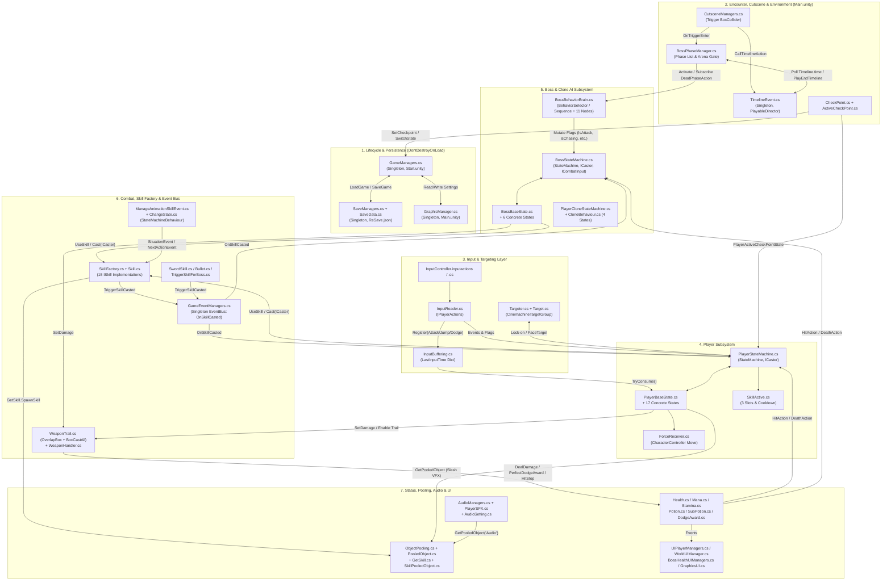
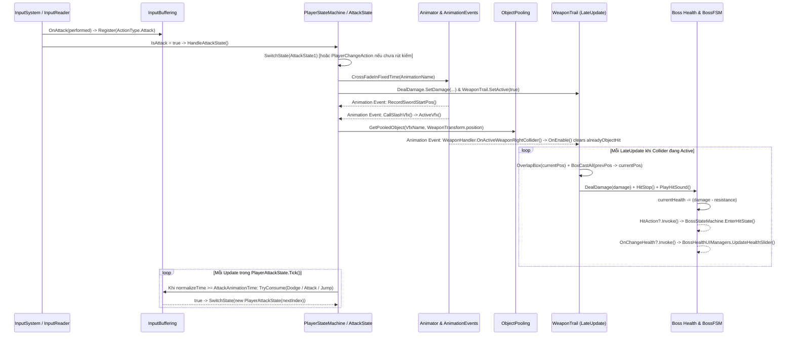

# RE-END — 01. Technical Architecture Map & Subsystem Analysis

- **Ngày khảo sát:** 2026-11-09
- **Unity Project Root:** `C:/Users/Official_41/Documents/Unity_Project/Unity_3D_Boss-Rush`
- **Nguyên tắc dẫn chứng:** Mọi nhận định kiến trúc dưới đây đều trích dẫn trực tiếp đường dẫn file tương đối từ project root, tên class/method và số dòng thực tế trong snapshot hiện tại.

---

## 1. Sơ Đồ Kiến Trúc Tổng Thể (Mermaid Architecture Diagram)

---

## 2. Phân Tích Chi Tiết Từng Subsystem

### 2.1. Entry Points, Bootstrap & Game Lifecycle (`Assets/Scripts/Managers/`)
- **Entry Point theo Build Settings (`ProjectSettings/EditorBuildSettings.asset:7-16`):**
  1. `Assets/Scenes/Start.unity` (Index 0): Chứa `GameManagers`, `SaveManagers`, `GameButtonManagers` và `StartMenuFeatures`.
  2. `Assets/Scenes/Main.unity` (Index 1): Scene gameplay chính chứa Player, toàn bộ các Boss container, UI, Audio, ObjectPooling, Timeline, GraphicManager.
  3. `Assets/Scenes/LoadScene.unity` (Index 2): Scene trung gian chứa `ProgressUI`.
- **Thành phần chính & Vai trò:**
  - `GameManagers` (`Assets/Scripts/Managers/GameManagers.cs:12-289`): Singleton `DontDestroyOnLoad` (`:33-43`). Đăng ký `SceneManager.sceneLoaded += OnSceneLoaded` (`:45`). Điều khiển:
    - `StartNewGame("Main")` (`:50-56`): Gọi `SaveManagers.Instance.CreateNewSaveGame()`, đặt `loadReason = ReasonLoadScene.New`, load thẳng `"Main"`.
    - `ContinueGame()` (`:58-74`): Gọi `SaveManagers.Instance.LoadGame()`, đặt `loadReason = ReasonLoadScene.Continue`, chuyển qua `"LoadScene"`, tại đó `ProgressUI.Start()` (`Assets/Scripts/UI/ProgressUI.cs:14-18`) đọc `SaveManagers.Instance.CurrentSaveData.sceneName` để load bất đồng bộ vào `"Main"`.
    - `ReturnCheckpoint()` (`:179-185`): Đặt `loadReason = ReasonLoadScene.Respawn` và reload active scene.
    - `OnSceneLoaded()` (`:92-114`): Tìm Player bằng `GameObject.FindGameObjectWithTag("Player")` (`:95`), nếu `Continue` hoặc `Respawn` thì gọi `ApplySaveData(player)` (`:116-169`) và `ResetStatus()` (`:259-288`).
  - `BossPhaseManager` (`Assets/Scripts/Managers/BossPhaseManager.cs:14-126`): Quản lý danh sách `List<BossBehaviorBrain> phases` (`:17`). Trong `Start()` (`:31-34, 46-53`), đăng ký `phase.DeadPhaseAction += CallTimelineAction` và tắt tất cả `phase.gameObject.SetActive(false)`. Trong `Update() -> HandleDeadPhaseAction()` (`:41-44, 65-107`), liên tục kiểm tra `TimelineEvent.Instance.Timeline.state` và tỷ lệ `Timeline.time / Timeline.duration >= 0.5f` (`:75`) để bật phase đầu tiên hoặc tắt phase vừa chết và bật phase kế tiếp (`:86-106`). Khi hết phase (`currentPhaseIndex == phases.Count`), phát `Finished?.Invoke()`, tắt Boss Health UI, tắt `Player.Stamina.IsCombat`, dừng nhạc nền, cộng `spiritualPower` cho Player (`:92-103`).
  - `CutsceneManagers` (`Assets/Scripts/Cutscene/CutsceneManagers.cs:7-59`): Gắn trên BoxCollider chặn cửa Boss. `Start()` (`:14-20`) kiểm tra `SaveManagers.Instance.CompletedList.Contains(bossPhaseManager.TriggerId)` để vô hiệu hóa collider nếu Boss đã bị hạ (`:28-32`). Khi Player chạm trigger (`OnTriggerEnter`, `:44-58`), gán Player vào `bossPhaseManager`, bật `player.Stamina.IsCombat = true`, bật `BossContainer.SetActive(true)`, gọi `TimelineEvent.Instance.CallTimelineAction()` và bật nhạc boss. Khi `bossPhaseManager.Finished` nổ, gọi `SaveIsDefeat()` (`:34-42`) để thêm `TriggerId` vào `CurrentSaveData.completedTriggerBoss` và gọi `GameManagers.Instance.AutoSave()`.

---

### 2.2. Input System & Input Buffering (`Assets/Scripts/Input/`)
- **Thành phần chính:**
  - `InputController.inputactions` & `InputController.cs`: Asset cấu hình Input System và class C# auto-generated implement `IPlayerActions`.
  - `InputReader` (`Assets/Scripts/Input/InputReader.cs:8-224`): Implement `InputController.IPlayerActions`. Chuyển đổi input thành:
    - Trạng thái đọc liên tục (Polling properties): `InputMovement` (`Vector2`), `Look` (`Vector2`), `IsSprint` (`bool`), `IsAttack` (`bool`), `IsHeavyAttack` (`bool`), `isCharging` (`bool`), `IsSetting` (`bool`).
    - Sự kiện tức thời (C# `event Action`): `JumpAction`, `DodgeAction`, `TargetAction`, `UsePotionAction`, `ChangeHealthPotionAction`, `ChangeManaPotionAction`, `UseSubPotionAction`, `ChangeNextSubPotionAction`, `ChangePrevSubPotionAction`, `SkillAction<int>`, `SettingsUIAction`, `ActiveCheckPointAction`.
  - `InputBuffering` (`Assets/Scripts/Input/InputBuffering.cs:20-65`):
    - Lưu cấu hình cửa sổ thời gian trong `_bufferWindowDictionary` và thời điểm nhấn cuối cùng trong `_lastInputTimeDictionary` (khởi tạo `-1000f` tại `Awake`, `:30-38`).
    - `InputReader` gọi `_inputBuffering.Register(ActionType)` tại 3 nơi: `OnAttack` (`InputReader.cs:85`, khi `context.performed`), `OnJump` (`:93`, khi `!context.canceled`), và `OnDodge` (`:100`, khi `!context.canceled`).
    - `TryConsume(ActionType)` (`InputBuffering.cs:51-64`): Kiểm tra `Time.time - lastTime <= bufferWindow`; nếu hợp lệ thì đặt lại `_lastInputTimeDictionary[actionType] = -1000f` và trả về `true`.
    - **Nơi tiêu thụ:** Chỉ được gọi trong `PlayerAttackState.Tick()` (`PlayerAttackState.cs:47, 53, 58` — sau khi `normalizeTime >= _attackData.AttackAnimationTime`, theo thứ tự ưu tiên `Dodge` → `Attack` → `Jump`) và `PlayerDodgeState.Tick()` (`PlayerDodgeState.cs:64` — khi `remainingTime < DodgeDuration * 0.2f`, chỉ kiểm tra `ActionType.Attack`).

---

### 2.3. Player Controller & Player State Machine (`Assets/Scripts/Design Pattern/StateMachine/Player/`)
- **Kiến trúc:** Flat Finite State Machine (FSM phẳng).
  - `State` (`Assets/Scripts/Design Pattern/StateMachine/Base/State.cs:5-29`): Lớp trừu tượng với `Enter()`, `Tick(float deltaTime)`, `Exit()` và helper `GetNormalizeTime(Animator, string animationTag, int layer)` (`:11-28`).
  - `StateMachine` (`Assets/Scripts/Design Pattern/StateMachine/Base/StateMachine.cs:5-21`): Giữ một `currentState` duy nhất; `SwitchState(State newState)` gọi `currentState?.Exit()` → gán `currentState = newState` → `currentState?.Enter()`; `Update()` gọi `currentState?.Tick(Time.deltaTime)`.
  - `PlayerStateMachine` (`Assets/Scripts/Design Pattern/StateMachine/Player/Base/PlayerStateMachine.cs:19-444`): Kế thừa `StateMachine` và implement `ICaster`. Đóng vai trò **Blackboard / Context trung tâm** của Player, giữ reference tới toàn bộ component (`InputReader`, `InputBuffering`, `CharacterController`, `ForceReceiver`, `Targeter`, `AttackData[]`, `WeaponTrail`, `SkillActive`, `Health`, `Mana`, `Stamina`, `DodgeAward`, `PlayerSFX`, `HealthPotion`, `ManaPotion`, `SubPotion`, `Animator`, `ManageAnimationSkillEvent`, các mesh `Normal`/`Indestructible`/`Invisible`, v.v.).
  - **Cơ chế khởi tạo State (Hybrid Caching vs New Allocation):**
    - Trong `SetupState()` (`PlayerStateMachine.cs:165-184`), 13 state được khởi tạo sẵn và lưu làm property (`FreeLookState`, `HitState`, `DeathState`, `JumpState`, `FallState`, `LandingState`, `TargetState`, `SkillState`, `DodgeState`, `AttackState1..4`, `HeavyAttack`, `UseMainPotionAction`).
    - Tuy nhiên, trong quá trình chạy, nhiều chỗ lại khởi tạo `new` state trực tiếp khi chuyển state: `new PlayerAttackState(playerStateMachine, _attackData.NextAttackDataIndex)` (`PlayerAttackState.cs:93`, `PlayerDodgeState.cs:66`), `new PlayerDodgeState(playerStateMachine)` (`PlayerAttackState.cs:49`), `new PlayerStartJumpState(playerStateMachine)` (`PlayerAttackState.cs:60`), `new PlayerFallState(playerStateMachine)` (`PlayerStartJumpState.cs:30`), `new PlayerCounterAttackState(playerStateMachine)` (`PlayerDodgeState.cs:92`), `new PlayerChangeAction(this, isAttack)` (`PlayerStateMachine.cs:230`), `new PlayerUseSubPotionState(this)` (`PlayerStateMachine.cs:286`), `new PlayerAffectedState(this, caster, effect)` (`PlayerStateMachine.cs:339`), `new PlayerActiveCheckPointState(...)` (`CheckPoint.cs:29`, `UIPlayerManagers.cs:321`).
- **Danh sách 17 Concrete States của Player:**
  1. `FreeLookState.cs`: Di chuyển tự do theo hướng camera (`CalculateMovementInFreeLook`), tiêu hao/hồi Stamina, lắng nghe input Jump/Dodge/Skill/Target/Potion/Attack/HeavyAttack.
  2. `PlayerTargetState.cs`: Di chuyển strafe 2D (`MovementX`, `MovementY`) luôn quay mặt về `Targeter.currentTarget` (`FaceTarget`), tự động rút kiếm (`EnterChangeAction(true)`) khi vào state (`:28-31`).
  3. `PlayerChangeAction.cs`: Chuyển trạng thái rút kiếm (`Sword_Enter`) / cất kiếm (`Sword_Exit`) trên Animator Layer 1 (`:44-53`) và dùng `AnimatorOverrideController` tại `Exit()` (`:91-101`, `PlayerBaseState.cs:76-81`) để ghi đè clip `Idle_Loop` ↔ `Sword_Idle`.
  4. `PlayerAttackState.cs`: Thực thi chuỗi combo 4 đòn từ `AttackData[]`, bật `WeaponTrail`, áp lực đẩy `ForceReceiver.AddForce` tại `ForceTime`, xoay VFX chém theo vector dịch chuyển mũi kiếm (`StartSwordPos` → `WeaponTrip.position`, `:110-121`), và đọc `InputBuffering` để nối combo hoặc cancel sang Dodge/Jump.
  5. `PlayerHeavyAttackState.cs`: Giữ nút sạc (`isCharging`) làm chậm `Animator.speed = 0.3f` tối đa `HoldTimeLimit = 1f` (`:60-78`), tính sát thương `AttackData[0].AttackDamage * _holdTime * 3f` (`:80-84`).
  6. `PlayerDodgeState.cs`: Né theo hướng input (`DodgeLength / DodgeDuration`), bật cửa sổ `Health.isPerfectDodge = true` đến khi `remainingTime <= 0.3f` (`:28, 52-55`), lắng nghe `DodgeAwardAction` và kiểm tra chuyển sang `PlayerCounterAttackState` (`:88-94`).
  7. `PlayerCounterAttackState.cs`: Đòn phản công sau Perfect Dodge (khi mở khóa nhánh `IsCounterAttack`), tăng `Animator.speed = 2f` và gây sát thương `AttackData[0].AttackDamage * 3` (`:14-16`).
  8. `PlayerStartJumpState.cs` → 9. `PlayerFallState.cs` → 10. `PlayerLandingState.cs`: Chuỗi nhảy (`ForceReceiver.Jump`), rơi trên không và tiếp đất.
  11. `PlayerUseSkillState.cs`: Kiểm tra cooldown (`skill.canUse`) và Mana, gọi `SkillFactory.CreateSkill(skillType)` và `skill.Cast(playerStateMachine)`, đồng thời đặt hẹn giờ hoàn trả trạng thái/material cho `NoDamage` (1s) và `Invisible` (5s) (`:65-95`).
  12. `PlayerUsePotionState.cs` & 13. `PlayerUseSubPotionState.cs`: Uống bình máu/mana chính hoặc 1 trong 3 bình phụ (`ReduceStamina`, `IncreaseDame`, `ReduceDame`).
  14. `PlayerHitState.cs`: Phản ứng bị đánh trúng, đẩy lùi (`-transform.forward * force`).
  15. `PlayerAffectedState.cs`: Nhận hiệu ứng khống chế từ kỹ năng Boss qua `GameEventManagers.OnSkillCasted` (`Stunned` giảm tốc, `PullBack` khóa input 2s, `AttractiveForce` hút về phía Boss với tốc độ `20f`).
  16. `PlayerActiveCheckPointState.cs`: Dùng chung cho cả ngồi nghỉ tại Checkpoint (`_isCheckpoint = true`) và mở menu Pause/Settings ngoài Checkpoint (`_isCheckpoint = false`), tự động gọi `GameManagers.Instance.AutoSave()` cả khi `Enter()` và `Exit()` (`:35, 63`).
  17. `PlayerDeathState.cs`: Phát animation chết, tắt `CharacterController`, gọi fade màn hình Defeat ở `normalizeTime >= 0.5f` và gọi `GameManagers.Instance.ReturnCheckpoint()` ở `normalizeTime > 0.99f` (`:35-45`).

---

### 2.4. Boss AI: Behavior Tree + Boss State Machine & PlayerClone (`Assets/Scripts/Design Pattern/Tree Behavior/` & `StateMachine/Boss/`)
- **Kiến trúc 2 tầng (Dual-Layer AI Architecture):**
  - **Tầng 1 — Quyết định (Behavior Tree trong `BossBehaviorBrain.cs:10-112`):**
    - Mỗi `Update()` (`:56-59`), `topNode.Evaluate()` duyệt cây `BehaviorSelector` gốc theo thứ tự ưu tiên cứng từ trái sang phải (`:94-103`):
      1. `CheckBossHealthNode`: Nếu `IsDead == true` → gọi `CallDeadPhaseAction()` (bắn event `DeadPhaseAction` tới `BossPhaseManager`) → trả `Success`.
      2. `CheckPlayerHealthNode`: Nếu `Player.currentHealth <= 0` → tắt `IsChasing = false` → trả `Success`.
      3. `changePhaseSequence` (`CheckChangePhaseNode` → `TaskChangePhaseNode`): Khi `CurrentPhase + 1 < Phase` và tỷ lệ máu Boss `<= NormalCombo[NextPhase].HealthThreshold`, tăng `CurrentPhase++` và `NextPhase = CurrentPhase + 1` (chuyển phase nội bộ trong cùng 1 prefab, ví dụ Juggernaut/Underwater).
      4. `ultSequence` (`CheckUltimateNode` → `TaskUltimateAttackNode`): Nếu chưa dùng Ultimate (`!IsUsedUltimate`) và có `UltimateCombo.AttackData.Length > 0`, bật `bossStateMachine.IsUltimateAttack = true` và giữ `Running` cho đến khi `IsFinishedAttack == true`.
      5. `counterAtkSequence` (`CheckCounterAttackNode` → `TaskCounterAttackNode`): Kiểm tra số đòn chịu đựng `HitReceived` so với ngưỡng ngẫu nhiên `Random.Range(EnduredTimes / 2, EnduredTimes + 1)` (`CheckCounterAttackNode.cs:22-23`); nếu khớp thì bật `bossStateMachine.IsCounterAttack = true`.
      6. `atkSequence` (`CheckAttackRangeNode` → `TaskAttackingNode`): Nếu đang ở trạng thái đuổi (`bossBehaviorBrain.IsChasingState == true`), khoảng cách tới Player `<= AttackRange`, Player còn sống và `!PlayerStateMachine.Invisible` (`CheckAttackRangeNode.cs:20-36`), bật `bossStateMachine.IsAttack = true` và giữ `Running` đến khi hết combo (`IsFinishedAttack`).
      7. `TaskChasingNode`: Luân phiên bật/tắt `IsChasingState` theo chu kỳ `ChaseDuration` và `IdleDuration` (`TaskChasingNode.cs:24-38`).
    - **Đặc điểm kỹ thuật của `BehaviorSequence` (`Assets/Scripts/Design Pattern/Tree Behavior/Base/BehaviorSequence.cs:14-34`):** Không dừng ngay khi gặp node con trả `Running` mà đánh giá tiếp các node con kế tiếp trong danh sách, chỉ dừng sớm khi gặp `Failure`.
  - **Tầng 2 — Thực thi (Boss FSM trong `BossStateMachine.cs:36-220`):**
    - `BossLocomotionState.cs` đọc các cờ boolean do Behavior Tree bật (`IsUltimateAttack`, `IsChasing`, `IsCounterAttack`, `IsAttack`) trong `Tick()` (`:27-53`) để chuyển sang `BossUltimateState`, `BossCounterAttackState`, hoặc `BossAttackState`.
    - `BossAttackState.cs` và `BossUltimateState.cs` duyệt qua mảng `AttackData[]` theo `NextAttackDataIndex`, gọi `UseSkill(_attackData.SkillType)` trong `Enter()` (`BossAttackState.cs:37`, `BossUltimateState.cs:33`), áp lực lướt `ForceReceiver.AddForce` và tự quay mặt về `bossStateMachine.Target` mỗi frame (`FaceTarget`). Khi `NextAttackDataIndex == -1`, đặt `IsFinishedAttack = true` và về `ReturnLocomotion()`.
    - `BossHitState.cs`: Được kích hoạt trực tiếp từ sự kiện `Health.HitAction += EnterHitState` (`BossStateMachine.cs:119, 160-163`), tăng `BossBehaviorBrain.HitReceived++` (`BossHitState.cs:19`).
    - `BossDeathState.cs`: Được kích hoạt từ `Health.DeathAction += EnterDeathState` (`BossStateMachine.cs:120, 165-168`), tắt `CharacterController` và khi animation đạt `normalizeTime >= 0.9f` thì đặt `BossBehaviorBrain.IsDead = true` (`BossDeathState.cs:32-38`).
- **PlayerClone AI (`Assets/Scripts/Design Pattern/StateMachine/PlayerClone/`):**
  - Khi Player dùng kỹ năng `PhantomMirage` (`Skill.cs:187-214`), một `PlayerClone` được lấy từ `ObjectPooling`.
  - `PlayerCloneStateMachine.OnEnable()` (`PlayerCloneStateMachine.cs:43-48`) tìm mục tiêu bằng `GameObject.FindGameObjectWithTag("Boss")` và vào `PlayerCloneIdleState` → sau `ChangeChasingState` giây chuyển sang `PlayerCloneChasingState` → khi đủ tầm `AttackRange` chuyển sang `PlayerCloneAttackState`. `CloneBehaviour.cs` đếm ngược `timeToRelease` để gọi `pooledObject.Release(gameObject.name)`.

---

### 2.5. Combat System, Hit Detection, Perfect Dodge & Counter Attack (`Assets/Scripts/Attack/`)
- **Quét va chạm vũ khí (`WeaponTrail.cs:8-106`):**
  - Gắn trực tiếp lên các GameObject hitbox của vũ khí Player, Boss, Clone và Projectile (`FireBullet`, `Phase_II_AOE`, `PullBack`, `PhantomRetreat`).
  - Trong `LateUpdate()` (`:40-64`):
    1. Tính tâm hộp thế giới `currentPosition = transform.TransformPoint(_collider.center)` và `halfExtend = Vector3.Scale(_collider.size, transform.lossyScale) * 0.5f`.
    2. Quét tĩnh tại vị trí hiện tại: `Physics.OverlapBox(currentPosition, halfExtend, transform.rotation, _layerMask)` (`:48`).
    3. Nếu `sweepDistance = Vector3.Distance(previousPosition, currentPosition) > 0.01f`, quét đường đi giữa 2 frame: `Physics.BoxCastAll(previousPosition, halfExtend, direction, transform.rotation, sweepDistance, _layerMask)` (`:54-61`).
  - Chống trùng hit bằng `List<GameObject> alreadyObjectHit` (`:17, 75-77`), được xóa khi `OnEnable()` (`:29-33`) hoặc gọi `ResetObjectHitList()` (`:35-38`).
  - `WeaponHandler.cs` (`Assets/Scripts/Attack/WeaponHanldler.cs:6-105`): Chứa các callback Animation Event (`OnActiveWeaponRightCollider`, `OnUnActiveWeaponRightCollider`, `OnActiveWeaponLeftCollider`, `OnActiveOtherCollider`, `OnGetWeapon`, `OnStoreWeapon`, v.v.) để bật/tắt GameObject chứa `WeaponTrail`, từ đó kích hoạt `WeaponTrail.OnEnable()` và xóa `alreadyObjectHit`.
- **Xử lý sát thương, Perfect Dodge & HitStop (`WeaponTrail.cs:72-90` & `Health.cs:79-127`):**
  1. Khi `DealDamage(GameObject other)` tìm thấy `Health` trên `other` (`WeaponTrail.cs:79`), nó gọi **`health.PerfectDodgeAward()` trước tiên** (`:81`).
  2. Trong `Health.PerfectDodgeAward()` (`Health.cs:116-122`): Nếu `isPerfectDodge == true` (đang ở đầu cú né của `PlayerDodgeState`), nó bật `noDamage = true`, phát `DodgeAwardAction?.Invoke()` (kích hoạt `DodgeAward.DodgeAwardActive()`) và chạy `SlowTime()` (`Time.timeScale = 0.5f` trong `0.8s` realtime).
  3. Tiếp theo, `WeaponTrail.DealDamage` kiểm tra `if (health.noDamage) return;` (`WeaponTrail.cs:83`). Nếu `noDamage == true`, đòn đánh bị miễn nhiễm hoàn toàn.
  4. Nếu không miễn nhiễm, gọi `health.DealDamage(damage)` (`Health.cs:79-91`):
     - Tính `currentHealth = Mathf.Clamp(currentHealth - damage + resistance, 0, maxHealth)` (`:83`).
     - Phát `HitAction?.Invoke()` (`:84`), nếu `currentHealth <= 0` phát `DeathAction?.Invoke()` (`:86-89`), và phát `OnChangeHealth?.Invoke(currentHealth / maxHealth)` (`:90`).
     - Gọi `health.HitStop()` (`WeaponTrail.cs:86` → `Health.cs:99-105, 124-127`) đặt `Time.timeScale = timeFreeze` trong `timeToBackNormal` giây realtime.

---

### 2.6. Skill System, Skill Factory, Event Bus & Object Pooling
- **Skill Factory (`Assets/Scripts/Attack/Skill Factory/`):**
  - `ICaster.cs`: Interface chung cho cả `PlayerStateMachine` và `BossStateMachine` (`ComsumeMana`, `GetTransform`, `TargetCaster`).
  - `ISkill.cs`: Interface định nghĩa `SkillEffect`, `SkillName`, `AnimationName`, `ManaCost`, `Cast(ICaster)`.
  - `SkillFactory.cs`: Static method `CreateSkill(SkillType)` dùng `switch` expression khởi tạo 15 class `ISkill` cụ thể nằm trong `Skill.cs`.
- **Event Bus & Animation Event Synchronization (`Assets/Scripts/Design Pattern/EventBus/`):**
  - `GameEventManagers.cs`: Singleton giữ `event Action<ICaster, SkillEffect> OnSkillCasted`. Khi một skill được tung ra (hoặc khi collider của `SwordSkill.OnTriggerEnter` / `TriggerSkillForBoss.OnTriggerEnter` chạm mục tiêu), nó gọi `GameEventManagers.Instance.TriggerSkillCasted(caster, effect)`. Cả `PlayerStateMachine` (nhận hiệu ứng từ Boss qua `HandleEffectedState`) và `BossStateMachine` (nhận hiệu ứng `Inescapable` / `Invisible` từ Player qua `HandleSkillEvent`) đều lắng nghe sự kiện này.
  - `ManageAnimationSkillEvent.cs` & `ChangeState.cs`: Nhiều kỹ năng Boss (`ThrowSword`, `JumpToSword`, `PullBack`, `FirstAoe`, `FireBullet`, `TransformToTwoSword`, `TransformToBlade`) và kỹ năng Player (`Indestructible`) không sinh hiệu ứng ngay trong `Cast()`, mà đăng ký một closure `Action situationAction` vào `ManageAnimationSkillEvent.SituationEvent`. Khi Animator chạy tới mốc `normalizedTime >= triggerSkillSituation`, `ChangeState.OnStateUpdate()` (`Assets/Scripts/UI/ChangeState.cs:54-60`) hoặc Animation Event trên clip sẽ gọi `SendSituationEvent()` để kích hoạt closure đó đúng khung hình animation.
- **Object Pooling (`Assets/Scripts/Design Pattern/Object Pooling/`):**
  - `ObjectPooling.cs`: Trong `Start() -> Setup()` (`:36-75`), khởi tạo trước các `PooledObject` theo `poolItemList` vào `Dictionary<string, Stack<PooledObject>>`.
  - `GetPooledObject(string objectName, Vector3 objectPosition)` (`:78-102`): Nếu Stack còn phần tử thì `Pop()`, gán `transform.position` và `SetActive(true)`; nếu Stack rỗng thì `Instantiate` thêm phần tử mới.
  - `ReturnToPool(string objectName, PooledObject pooledObject)` (`:104-114`): Gọi `SetActive(false)` và `Push()` lại vào Stack (được bảo vệ bởi cờ `isReleased` trong `PooledObject.cs:9-23`).

---

## 3. Luồng Hoạt Động Chính (End-to-End Execution Flows)

### 3.1. Luồng từ Input của Player đến Gameplay Logic, Animation, Hit Detection và Phản Hồi

### 3.2. Luồng Vòng Đời Encounter Boss & Chuyển Phase (`CutsceneManagers` → `BossPhaseManager` → `BossBehaviorBrain`)
1. **Khởi đầu (`Main.unity`):** `BossContainer` đang inactive hoặc các `BossBehaviorBrain` trong `BossPhaseManager.phases` bị đặt `SetActive(false)` tại `BossPhaseManager.Start()` (`BossPhaseManager.cs:46-53`).
2. **Kích hoạt:** Player đi qua cổng Boss → `CutsceneManagers.OnTriggerEnter()` (`CutsceneManagers.cs:44-58`) bật `player.Stamina.IsCombat = true`, bật `BossContainer.SetActive(true)`, vô hiệu hóa trigger collider, gọi `TimelineEvent.Instance.CallTimelineAction()` và `AudioManagers.Instance.PlayerBackgroundMusic(true)`.
3. **Vào Phase 1:** `BossPhaseManager.Update() -> HandleDeadPhaseAction()` (`BossPhaseManager.cs:65-84`) đợi `Timeline.time / Timeline.duration >= 0.5f` với `!firstTime`, sau đó bật hạt chặn cổng `ActiveLockGateParticle()` và bật `phases[0].gameObject.SetActive(true)`.
4. **Chiến đấu & Kết thúc Phase:**
   - Với Boss 1 prefab nhiều phase nội bộ (như Juggernaut / Underwater): `CheckChangePhaseNode` + `TaskChangePhaseNode` tăng `CurrentPhase` khi máu xuống dưới `HealthThreshold`.
   - Với Boss nhiều prefab theo từng phase (như Nordic Phase I → II → III): Khi máu một phase về `0`, `Health.DeathAction` đưa Boss vào `BossDeathState`. Ở `normalizeTime >= 0.9f`, `BossDeathState` đặt `BossBehaviorBrain.IsDead = true` (`BossDeathState.cs:36`). Frame tiếp theo, `CheckBossHealthNode.Evaluate()` gọi `BossBehaviorBrain.CallDeadPhaseAction()` (`CheckBossHealthNode.cs:21`), phát sự kiện `DeadPhaseAction` → `BossPhaseManager.CallTimelineAction()` phát Timeline chuyển phase → khi Timeline qua mốc `50%`, `BossPhaseManager` tắt phase cũ (`phases[currentPhaseIndex].gameObject.SetActive(false)`), tăng `currentPhaseIndex++` và bật phase mới (`BossPhaseManager.cs:86-106`).
5. **Chiến thắng:** Khi `currentPhaseIndex == phases.Count` (`BossPhaseManager.cs:92-104`), `BossPhaseManager` phát `Finished?.Invoke()` (để `CutsceneManagers.SaveIsDefeat()` lưu `TriggerId` và `AutoSave()`), tắt UI máu Boss, tắt `Player.Stamina.IsCombat = false`, dừng nhạc nền, cộng `Player.AddBossSpiritualPower(spiritualPower)` và nếu `isFinalBoss` thì phát `TimelineEvent.Instance.PlayEndTimeline()`.

---

## 4. Các Kiến Trúc & Design Pattern Đã Xác Minh Trong Thực Tế

| Pattern / Kiến trúc | Trạng thái xác minh | File triển khai thực tế | Đánh giá kỹ thuật |
|---|---|---|---|
| **Finite State Machine (Flat FSM)** | **Đang dùng cốt lõi** | `State.cs`, `StateMachine.cs`, `PlayerStateMachine.cs`, `BossStateMachine.cs`, `PlayerCloneStateMachine.cs` | Tổ chức rõ ràng theo `Enter/Tick/Exit`. Tuy nhiên trộn lẫn giữa cached states (`SetupState`) và `new State()` runtime. |
| **Behavior Tree (BT)** | **Đang dùng cốt lõi cho Boss AI** | `BehaviorNode.cs`, `BehaviorSelector.cs`, `BehaviorSequence.cs`, `BossBehaviorBrain.cs` + 11 leaf nodes | Kết hợp BT (ra quyết định) + FSM (thực thi). Lưu ý `BehaviorSequence` đánh giá tiếp cả khi node con trả `Running`. |
| **Simple Static Factory** | **Đang dùng cốt lõi** | `SkillFactory.cs`, `ISkill.cs`, `ICaster.cs`, `Skill.cs` | Tạo 15 kỹ năng của Player và Boss qua `switch` expression. Đơn giản, trực quan nhưng các class `ISkill` bên trong `Skill.cs` vẫn ép kiểu `GetComponent<PlayerStateMachine>()` / `GetComponent<BossStateMachine>()`. |
| **Object Pooling (Stack-based)** | **Đang dùng cốt lõi** | `ObjectPooling.cs`, `PooledObject.cs`, `GetSkill.cs`, `SkillPooledObject.cs`, `CloneBehaviour.cs` | Dùng `Dictionary<string, Stack<PooledObject>>` cho VFX, Projectile, Clone và Audio. Tự mở rộng bằng `Instantiate` khi cạn pool. |
| **Event Bus & C# Observer Events** | **Đang dùng cốt lõi** | `GameEventManagers.cs`, `ManageAnimationSkillEvent.cs`, `Health.cs`, `InputReader.cs`, `UIPlayerManagers.cs` | Giao tiếp giữa Status ↔ UI và Skill ↔ Actor qua C# `event Action`. Tuy nhiên `TickSystem.cs` trong thư mục `Observer` là dead code (không có subscriber). |
| **Singleton (`MonoBehaviour`)** | **Đang dùng rộng rãi (7 class)** | `GameManagers`, `SaveManagers`, `GraphicManager` (`DontDestroyOnLoad`); `AudioManagers`, `ObjectPooling`, `GameEventManagers`, `TimelineEvent`, `WorldUIManager` (Scene-bound) | Tiện truy cập toàn cục nhưng tạo coupling chặt và phụ thuộc thứ tự `Awake()`/`Start()`. |
| **Data-Driven / ScriptableObject** | **Chưa hoàn thiện (Chỉ dùng Serializable Class)** | `AttackData.cs` (`[Serializable]`), `SaveData.cs` (`[Serializable]`), `AttackDatas.cs` (`ScriptableObject` bỏ trống) | Dữ liệu đòn đánh và kỹ năng đang được cấu hình trực tiếp trên Inspector của Prefab thông qua `[Serializable]` class (`AttackData`, `SkillActiveType`), không phải `.asset` độc lập. |

---

## 5. Phân Tích Coupling, Dependency & Các Dấu Hiệu Đáng Nghi Cần Kiểm Tra Sâu Ở Giai Đoạn 2

> [!IMPORTANT]
> Theo Nguyên tắc 5 và Bước 5 của phương pháp khảo sát, các mục dưới đây là **những dấu hiệu rủi ro kỹ thuật có bằng chứng rõ ràng từ mã nguồn**, được ghi nhận chính xác kèm vị trí dòng code để bàn giao cho Giai đoạn 2 kiểm chứng chuyên sâu.

### 5.1. Coupling Cao & Phụ Thuộc Ngược Giữa Các Lớp
1. **`Health.cs` phụ thuộc ngược vào `PlayerStateMachine` và `Boss` tag (`Assets/Scripts/Attack/Status/Health.cs:47-51, 65-77, 129-173`):**
   - Dù `Health` được dùng chung cho cả Player, Boss và PlayerClone, `Health.Awake()` và `Health.Update()` kiểm tra cứng `if (gameObject.tag != "Boss")`, đồng thời chứa cả logic cộng/trừ điểm nâng cấp (`isCanNotSubSpiritual`, `isCanNotAddSpiritual`) của `PlayerStateMachine` và logic `FinalPhaseAction` / `EndGameAction` (hai event này thậm chí không có nơi nào đăng ký).
2. **`ISkill` phụ thuộc chặt vào kiểu cụ thể `PlayerStateMachine` và `BossStateMachine` (`Assets/Scripts/Attack/Skill Factory/Skill.cs`):**
   - Dù `ISkill.Cast(ICaster caster)` nhận interface `ICaster`, hầu hết các skill đều gọi `caster.GetTransform().GetComponent<PlayerStateMachine>()` (`Skill.cs:21, 47, 85, 144, 167, 198`) hoặc `GetComponent<BossStateMachine>()` (`Skill.cs:227, 258, 283, 298, 326, 340, 374, 409, 438`), làm giảm tính trừu tượng của `ICaster`.
3. **Phụ thuộc tìm kiếm đối tượng runtime qua Tag (`FindWithTag` / `FindGameObjectWithTag`):**
   - Được dùng tại `GameManagers.cs:95, 119, 181, 195, 261`, `PlayerStateMachine.cs:157`, `BossStateMachine.cs:103`, `PlayerCloneStateMachine.cs:45`, `SwordSkill.cs:29`. Đặc biệt `SwordSkill.OnEnable()` (`SwordSkill.cs:29-31`) tìm `"Boss"` rồi gọi `GetComponentInChildren<BossStateMachine>(true)` (`includeInactive = true`), có nguy cơ lấy nhầm phase Boss đang inactive trong container nhiều phase.

### 5.2. Các Dấu Hiệu Rủi Ro Logic & Vòng Đời Cần Phân Tích Sâu (Giai Đoạn 2)
1. **Thứ tự khởi tạo Save/Load & `CurrentSaveData` có thể `null` ở `Start()`:**
   - `SaveManagers.Awake()` (`SaveManagers.cs:23-33`) **không** tự động gọi `LoadGame()`. Khi vào `Main.unity` trực tiếp trong Editor hoặc khi `GraphicManager.Start() -> LoadApplyAll()` (`GraphicManager.cs:60-63, 186-205`) và `GraphicsUI.Start() -> LoadCurrentValuesToUI()` (`GraphicsUI.cs:90-109`) kiểm tra `if (!SaveManagers.Instance.HaveSaveData())`, nếu file `ReSave.json` đã tồn tại trên ổ cứng nhưng người chơi chọn **New Game** (hoặc chưa gọi `LoadGame()`), `CurrentSaveData` sẽ là một `new SaveData()` rỗng (mọi chỉ số = 0) hoặc `null`, dẫn tới áp cấu hình đồ họa `0` hoặc `NullReferenceException` tại `TriggerActiveTutorials.Start()` (`TriggerActiveTutorials.cs:22`).
2. **Bất đồng bộ giữa `CompletedList` (`HashSet`) và `CurrentSaveData.completedTriggerBoss` (`List`):**
   - `CutsceneManagers.CheckDefeat()` (`CutsceneManagers.cs:30`) kiểm tra `SaveManagers.Instance.CompletedList.Contains(...)`, nhưng `SaveIsDefeat()` (`:36-39`) chỉ ghi vào `SaveManagers.Instance.CurrentSaveData.completedTriggerBoss`. Trong khi đó `CompletedList` chỉ được tạo lại duy nhất trong `SaveManagers.LoadGame()` (`SaveManagers.cs:66`), không được cập nhật khi hạ Boss trong cùng phiên chơi và không được xóa trong `CreateNewSaveGame()` hay `DeteleSaveGame()` (`:70-85`).
3. **Thứ tự lưu game và cộng thưởng khi hạ Boss (`BossPhaseManager.cs:92-100` & `SaveData.cs`):**
   - `BossPhaseManager.HandleDeadPhaseAction()` gọi `Finished?.Invoke()` (kích hoạt `CutsceneManagers.SaveIsDefeat() -> GameManagers.Instance.AutoSave()`) ở dòng `94` **trước khi** gọi `Player.AddBossSpiritualPower(spiritualPower)` ở dòng `100`. Hơn nữa, `SaveData.cs` hoàn toàn chưa có trường lưu `PlayerSpiritualPower`, và `AutoSave()` chỉ lưu `stateMachine.AttackData[0].AttackDamage` (`GameManagers.cs:227`) rồi khi load lại gán đè giá trị đó cho toàn bộ các đòn trong `stateMachine.AttackData` (`GameManagers.cs:142-145`).
4. **Công thức sát thương cộng `resistance` và không chặn khi đã chết (`Health.cs:79-91`):**
   - `currentHealth = Mathf.Clamp(currentHealth - damage + resistance, 0, maxHealth);` (`Health.cs:83`): Nếu `damage < resistance` (ví dụ đòn Heavy Attack sạc ngắn có `_holdTime` nhỏ trong `PlayerHeavyAttackState.cs:82`), lượng máu không những không giảm mà còn **tăng thêm** (`- damage + resistance > 0`). Đồng thời `DealDamage` luôn phát `HitAction` trước `DeathAction` ngay cả khi đòn đánh đó làm `currentHealth <= 0`, khiến nhân vật chuyển vào `HitState` rồi lập tức chuyển sang `DeathState`.
5. **Xung đột trạng thái Bất Tử / Tàng Hình / TimeScale giữa nhiều hệ thống:**
   - Trong `Skill.cs:113-115` (`Invisible.Cast`), callback kết thúc sau 4 giây gán `player.Invisible = false;` ở dòng `113` rồi ngay dòng `115` lại gán đè `player.Invisible = true;`! (May mắn là `PlayerUseSkillState.cs:83-87` có một coroutine thứ hai chạy sau 5 giây gán lại `player.Invisible = false;`, nhưng coroutine 5 giây đó lại gọi `ResetToMainMaterial()` vốn chỉ bật/tắt mesh `Indestructible` chứ không phải mesh `Invisible`).
   - `Health.TimeFreeHit()` (`Health.cs:99-105`) và `Health.SlowTime()` (`:107-114`) cùng ghi đè `Time.timeScale` và trả về `1f` độc lập nhau.
6. **Vòng đời đăng ký sự kiện `OnSkillCasted` và `ManageAnimationSkillEvent.SituationEvent`:**
   - Cả `PlayerStateMachine` (`:183, 196`) và `BossStateMachine` (`:114, 131`) đăng ký `GameEventManagers.Instance.OnSkillCasted` trong `Start()`, nhưng `PlayerStateMachine` lại hủy đăng ký trong `OnDisable()`. Nếu Player bị disable rồi enable lại, `Start()` không chạy lại nên mất kết nối sự kiện.
   - Các skill Boss (`ThrowSword`, `FirstAoe`, `PullBack`, `TransformToTwoSword`, `TransformToBlade`) cộng dồn listener vào `ManageAnimationSkillEvent.SituationEvent` trong `Cast()`, nhưng nếu Boss bị ngắt đòn (dính `HitAction` sang `BossHitState`) trước khi animation tới mốc phát event, listener cũ không được gỡ ra và sẽ nổ nhầm ở animation tiếp theo.
7. **Chuyển State nhưng không `return` ngay trong `Tick()`:**
   - Trong `PlayerAttackState.Tick()` (`PlayerAttackState.cs:53-56`), khi `TryConsume(ActionType.Attack)` gọi `TryCombo() -> SwitchState(...)`, hàm không `return` mà tiếp tục kiểm tra `TryConsume(ActionType.Jump)`, `TryApplyForce()`, `FaceTarget()` và `Move()` trên state cũ. Tương tự ở `PlayerDodgeState.Tick()` (`:42, 64-67`), `BossLocomotionState.Tick()` (`:29-32, 49-50`), và `PlayerCloneIdleState.Tick()` (`:25-29` — gọi `SwitchState(AttackState)` ở dòng 27 rồi ngay dòng 29 gọi đè `SwitchState(ChasingState)`!).
