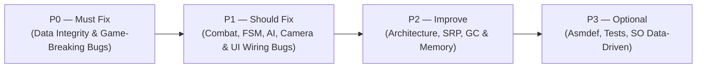

# RE-END — 05. Technical Improvement & Remediation Roadmap (`05_Improvement_Roadmap.md`)

- **Ngày lập kế hoạch:** 2026-11-09
- **Nguyên tắc:** Sắp xếp toàn bộ 29 phát hiện kỹ thuật theo mức độ ưu tiên (`P0` → `P3`) dựa trên mức độ đe dọa tính đúng đắn của gameplay và toàn vẹn dữ liệu. Không ước lượng theo số giờ/ngày cứng mà đánh giá theo **Độ phức tạp kỹ thuật (`Trivial` / `Low` / `Medium` / `High`)**, **Dependency**, **Phạm vi ảnh hưởng**, và **Điều kiện xác nhận hoàn thành (Definition of Done)**.

---

## Tổng quan Lộ trình Thực thi (Execution Flow)

---

## Nhóm P0 — Must Fix (Khẩn cấp: Đe dọa tính đúng đắn cốt lõi hoặc làm hỏng dữ liệu Save)

### P0-01: Khôi phục tính toàn vẹn của Hệ thống Save/Load, Respawn New Game và Tiến trình Boss (`[LIFE-01]`, `[LIFE-02]`, `[LIFE-03]`)
- **Lý do ưu tiên:**
  - Nếu người chơi bấm **New Game** và chết ở Boss đầu tiên trước khi chạm Checkpoint, `ReturnCheckpoint()` nạp `new SaveData()` toàn số `0` khiến nhân vật hồi sinh tại `(0,0,0)` với `0` HP / `0` Mana / `0` Stamina / `0` Damage (`[LIFE-01]`).
  - `AutoSave()` chạy trước khi cộng `spiritualPower` khi hạ Boss; `SaveData` không lưu `PlayerSpiritualPower`, không lưu `potionUsage`, và ghi đè sát thương cả 4 đòn combo về bằng đòn đầu tiên (`[LIFE-02]`).
  - `SaveManagers.CompletedList` không được cập nhật khi hạ Boss và không được xóa khi `CreateNewSaveGame()` (`[LIFE-03]`).
- **Kết quả mong đợi:**
  - Chết trước khi chạm Checkpoint trong New Game sẽ hồi sinh đúng tại điểm xuất phát ban đầu với đầy đủ chỉ số gốc của Prefab.
  - Điểm `PlayerSpiritualPower`, sát thương riêng của từng đòn trong 4 đòn combo (`40/40/45/50`), và danh sách Boss đã hạ (`CompletedList`) được bảo toàn chính xác qua mọi thao tác `AutoSave`, `Respawn`, `Continue`, và `New Game`.
- **Độ phức tạp ước tính:** `Low`
- **Dependency:** Không có (nên thực hiện đầu tiên).
- **Phạm vi ảnh hưởng:**
  - [`SaveData.cs`](file:///C:/Users/Official_41/Documents/Unity_Project/Unity_3D_Boss-Rush/Assets/Scripts/Managers/SaveData.cs)
  - [`SaveManagers.cs`](file:///C:/Users/Official_41/Documents/Unity_Project/Unity_3D_Boss-Rush/Assets/Scripts/Managers/SaveManagers.cs)
  - [`GameManagers.cs`](file:///C:/Users/Official_41/Documents/Unity_Project/Unity_3D_Boss-Rush/Assets/Scripts/Managers/GameManagers.cs)
  - [`BossPhaseManager.cs`](file:///C:/Users/Official_41/Documents/Unity_Project/Unity_3D_Boss-Rush/Assets/Scripts/Managers/BossPhaseManager.cs)
  - [`CutsceneManagers.cs`](file:///C:/Users/Official_41/Documents/Unity_Project/Unity_3D_Boss-Rush/Assets/Scripts/Cutscene/CutsceneManagers.cs)
- **Điều kiện xác nhận hoàn thành (DoD):**
  1. Bấm New Game -> chạy thẳng vào Boss để chết -> hồi sinh tại vị trí khởi đầu với `maxHealth = 500`, `maxMana = 100`, `maxStamina = 1000`, `AttackDamage = [40, 40, 45, 50]`.
  2. Hạ Boss 1 -> nhận `spiritualPower` -> thoát ra Menu -> bấm Continue -> kiểm tra `PlayerSpiritualPower` giữ nguyên và cổng Boss 1 đã mở (`CompletedList.Contains(TriggerId) == true`).
  3. Từ Menu bấm New Game -> xác nhận `CompletedList.Count == 0` và mọi Boss xuất hiện đầy đủ.

---

### P0-02: Sửa lỗi tên định danh `SubPotion` và nối lại 6 nút UI Sub-Potion trong `Main.unity` (`[COMBAT-01]`, `[LIFE-04]`)
- **Lý do ưu tiên:** Toàn bộ tính năng Sub-Potion (3 bình tăng sát thương, giảm sát thương nhận vào, giảm tiêu hao Stamina) đang hỏng 100%: uống thuốc bị trừ số lượng nhưng không có hiệu ứng buff, và 6 nút `+`/`-` trên UI Checkpoint bị đứt tham chiếu `m_Target: {fileID: 0}`.
- **Kết quả mong đợi:**
  - Người chơi có thể mua/trừ 3 loại Sub-Potion tại Checkpoint UI.
  - Khi bấm phím uống Sub-Potion trong trận đấu, hiệu ứng tương ứng (`ReduceStamina` cho `"EmeraldGuava"`, `ReduceDame` cho `"GoldenPear"`, `IncreaseDame` cho `"BloodPomegranate"`) được kích hoạt đúng trong `timeToDone` (`20s`).
- **Độ phức tạp ước tính:** `Low`
- **Dependency:** Không có.
- **Phạm vi ảnh hưởng:**
  - [`PlayerUseSubPotionState.cs:37-52`](file:///C:/Users/Official_41/Documents/Unity_Project/Unity_3D_Boss-Rush/Assets/Scripts/Design%20Pattern/StateMachine/Player/Main/PlayerUseSubPotionState.cs#L37-L52)
  - [`SubPotion.cs:79-101`](file:///C:/Users/Official_41/Documents/Unity_Project/Unity_3D_Boss-Rush/Assets/Scripts/Attack/Status/Potion/SubPotion.cs#L79-L101)
  - `Assets/Scenes/Main.unity` (6 Button `AddSubPotionQuantity` / `SubtractSubPotionQuantity`)
- **Điều kiện xác nhận hoàn thành (DoD):**
  1. Bấm `+` / `-` tại tab Sub-Potion ở Checkpoint làm tăng/giảm đúng số lượng bình và trừ/hoàn đúng `PlayerSpiritualPower`.
  2. Uống lần lượt 3 bình trong Play Mode và xác nhận các cờ `stamina.isReduceStamina`, `health.isReduceDame`, `_playerStateMachine.IsIncreaseDamePotion` bật thành `true` trong 20 giây rồi tự tắt.

---

### P0-03: Sửa công thức sát thương và bảo vệ trạng thái sống/chết trong `Health.DealDamage()` (`[COMBAT-02]`, `[COMBAT-03]`)
- **Lý do ưu tiên:**
  - Đòn đánh có `damage < resistance` hiện đang hồi máu cho mục tiêu.
  - Đòn đánh kết liễu gọi đồng thời cả `HitAction` và `DeathAction`, và mục tiêu đã chết (`currentHealth <= 0`) vẫn tiếp tục nhận sát thương và phát lại `DeathAction`.
- **Kết quả mong đợi:**
  - Sát thương sau khi trừ `resistance` luôn `>= 0` (`Mathf.Max(0f, damage - resistance)`).
  - Mục tiêu đã có `currentHealth <= 0f` bỏ qua mọi lệnh `DealDamage` tiếp theo.
  - Khi `currentHealth <= 0f`, chỉ phát `DeathAction` chứ không phát `HitAction`.
- **Độ phức tạp ước tính:** `Trivial`
- **Dependency:** Không có.
- **Phạm vi ảnh hưởng:**
  - [`Health.cs:79-91`](file:///C:/Users/Official_41/Documents/Unity_Project/Unity_3D_Boss-Rush/Assets/Scripts/Attack/Status/Health.cs#L79-L91)
- **Điều kiện xác nhận hoàn thành (DoD):**
  1. Gây sát thương `5` lên mục tiêu có `resistance = 10` -> máu không tăng.
  2. Khi Boss hoặc Player chết (`currentHealth == 0`), các đòn chém bồi thêm vào cơ thể đang ngã không kích hoạt lại `HitState` hay `DeathState`.

---

### P0-04: Sửa lỗi đột biến chỉ số vĩnh viễn và khóa kỹ năng của `WorldBreaker` (`[COMBAT-04]`)
- **Lý do ưu tiên:** Sử dụng `WorldBreaker` 1 lần sẽ khóa chết toàn bộ hệ thống Skill (`if (Invincible) return;`), làm chạy nước rút chậm hơn chạy thường (`SprintSpeed *= 0.8f`), và nhân đôi vĩnh viễn `AttackData[i].AttackDamage` vào file save `ReSave.json`.
- **Kết quả mong đợi:**
  - `WorldBreaker` chỉ tăng sát thương/tốc độ thông qua hệ số nhân tạm thời (hoặc hoàn trả chính xác về giá trị gốc sau khi hết thời gian hiệu lực, ví dụ 15 giây) và tắt VFX `WorldBreaker` trên vũ khí.
  - Không làm hỏng dữ liệu `AttackDamage` gốc khi `AutoSave()`.
- **Độ phức tạp ước tính:** `Low`
- **Dependency:** Phối hợp cùng `P0-01` (`SaveData`).
- **Phạm vi ảnh hưởng:**
  - [`PlayerStateMachine.cs:289-299, 367-376`](file:///C:/Users/Official_41/Documents/Unity_Project/Unity_3D_Boss-Rush/Assets/Scripts/Design%20Pattern/StateMachine/Player/Base/PlayerStateMachine.cs#L367-L376)
  - [`Skill.cs:135-161`](file:///C:/Users/Official_41/Documents/Unity_Project/Unity_3D_Boss-Rush/Assets/Scripts/Attack/Skill%20Factory/Skill.cs#L135-L161)
- **Điều kiện xác nhận hoàn thành (DoD):**
  1. Kích hoạt `WorldBreaker`, kiểm tra sau khi hết thời gian hiệu lực thì `Invincible == false`, tốc độ chạy và sát thương trở về gốc, và người chơi tiếp tục dùng được các kỹ năng khác.
  2. Lưu game trong lúc `WorldBreaker` đang bật không làm nhân đôi sát thương gốc trong `ReSave.json`.

---

### P0-05: Đóng lỗ hổng rút âm chỉ số để farm vô hạn `PlayerSpiritualPower` tại Checkpoint (`[COMBAT-05]`)
- **Lý do ưu tiên:** Người chơi có thể bấm nút `-` ở Health (`maxHealth = 500 != 1000`), Mana (`maxMana = 100 != 1000`) và Potion (`minimumPotionUsage = 0`) để rút máu/mana về âm và nhận vô hạn điểm nâng cấp `PlayerSpiritualPower`.
- **Kết quả mong đợi:**
  - Không thể giảm `maxHealth`, `maxMana`, `maxStamina`, `potionUsage` xuống thấp hơn giá trị khởi điểm ban đầu (`500`, `100`, `1000`, và mức sử dụng bình gốc).
- **Độ phức tạp ước tính:** `Trivial`
- **Dependency:** Không có.
- **Phạm vi ảnh hưởng:**
  - [`Health.cs:143-153`](file:///C:/Users/Official_41/Documents/Unity_Project/Unity_3D_Boss-Rush/Assets/Scripts/Attack/Status/Health.cs#L143-L153)
  - [`Mana.cs:45-55`](file:///C:/Users/Official_41/Documents/Unity_Project/Unity_3D_Boss-Rush/Assets/Scripts/Attack/Status/Mana.cs#L45-L55)
  - [`Stamina.cs:78-87`](file:///C:/Users/Official_41/Documents/Unity_Project/Unity_3D_Boss-Rush/Assets/Scripts/Attack/Status/Stamina.cs#L78-L87)
  - [`Potion.cs:23-29, 72-80`](file:///C:/Users/Official_41/Documents/Unity_Project/Unity_3D_Boss-Rush/Assets/Scripts/Attack/Status/Potion/Potion.cs#L72-L80)
- **Điều kiện xác nhận hoàn thành (DoD):**
  Khi vừa bắt đầu New Game, mở bảng nâng cấp tại Checkpoint và bấm nút `-` ở tất cả các dòng; xác nhận không có chỉ số nào giảm và `PlayerSpiritualPower` không tăng.

---

## Nhóm P1 — Should Fix (Quan trọng: Lỗi Gameplay, State Machine, AI, Camera & UI)

### P1-01: Tách biệt trạng thái Bất tử (`noDamage`) và điều phối `Time.timeScale` tập trung (`[COMBAT-06]`)
- **Lý do ưu tiên:** Dodge thoát ra (`PlayerDodgeState.Exit`) đang xóa mất bất tử của kỹ năng `Indestructible`; HitStop (`TimeFreeHit` `0.05s`) của Boss đang hủy sớm hiệu ứng Slow Motion (`0.8s`) của Perfect Dodge.
- **Kết quả mong đợi:**
  - Dùng bộ đếm tham chiếu (`_invulnerabilityCount > 0`) hoặc cờ riêng cho từng nguồn bất tử.
  - Quản lý `Time.timeScale` sao cho HitStop khi kết thúc sẽ trả về `0.5f` nếu cửa sổ Slow Motion của Perfect Dodge vẫn còn hiệu lực.
- **Độ phức tạp ước tính:** `Low`
- **Dependency:** Không có.
- **Phạm vi ảnh hưởng:** [`Health.cs`](file:///C:/Users/Official_41/Documents/Unity_Project/Unity_3D_Boss-Rush/Assets/Scripts/Attack/Status/Health.cs), [`PlayerDodgeState.cs`](file:///C:/Users/Official_41/Documents/Unity_Project/Unity_3D_Boss-Rush/Assets/Scripts/Design%20Pattern/StateMachine/Player/Main/PlayerDodgeState.cs), [`PlayerUseSkillState.cs`](file:///C:/Users/Official_41/Documents/Unity_Project/Unity_3D_Boss-Rush/Assets/Scripts/Design%20Pattern/StateMachine/Player/Main/PlayerUseSkillState.cs).
- **Điều kiện xác nhận hoàn thành (DoD):**
  1. Bật `Indestructible` -> bấm Dodge -> vẫn giữ được bất tử cho đến hết thời gian kỹ năng.
  2. Perfect Dodge -> chém trúng Boss ngay lập tức -> Slow Motion vẫn duy trì đủ `0.8s`.

---

### P1-02: Chuẩn hóa tính nguyên tử khi chuyển State (`SwitchState`), sửa `Targeter` Lock-on và kiểm tra tiến độ Animation (`[PLAYER-01]`, `[PLAYER-02]`, `[PLAYER-03]`, `[PLAYER-05]`, `[PLAYER-06]`, `[BOSS-01]`, `[BOSS-04]`)
- **Lý do ưu tiên:**
  - Thiếu `return;` sau `SwitchState` trong `PlayerTargetState`, `PlayerAttackState`, `PlayerDodgeState`, `PlayerCloneIdleState` khiến code của state cũ chạy đè lên state mới trong cùng 1 frame.
  - `Targeter.CancelTarget()` bị khóa khi `targetList.Count == 0` và `SelectedTarget()` khóa nhầm mục tiêu sau lưng Camera (`viewPoint.z < 0`).
  - `New State` trên `UpBodyLayer` của `Player.controller` gán nhầm tag `SwordChange`.
- **Kết quả mong đợi:**
  - Mọi lời gọi `SwitchState(...)` trong `Enter()` hoặc `Tick()` đều kết thúc frame hiện tại bằng `return;`.
  - `Targeter.CancelTarget()` kiểm tra `if (currentTarget == null) return;`, `OnTriggerExit` gọi `RemoveTarget(target)`, và `SelectedTarget()` kiểm tra `viewPoint.z > 0f`.
  - Xóa dòng `UpdateFreeLookAnimation` dư thừa ở `PlayerChangeAction.cs:87` và giới hạn tốc độ rơi tối đa trong `ForceReceiver.cs`.
  - Xóa tag `SwordChange` khỏi `New State` trên `UpBodyLayer` của `Player.controller`.
  - Bỏ comment `_previousTime = 0f; _alreadyApplyForce = false;` trong `BossAttackState.Enter()` và `BossUltimateState.Enter()`.
- **Độ phức tạp ước tính:** `Low`
- **Dependency:** Không có.
- **Phạm vi ảnh hưởng:** `PlayerTargetState`, `PlayerAttackState`, `PlayerDodgeState`, `PlayerChangeAction`, `PlayerCloneIdleState`, `BossAttackState`, `BossUltimateState`, `Targeter`, `ForceReceiver`, `Player.controller`.
- **Điều kiện xác nhận hoàn thành (DoD):**
  Kiểm tra chuyển đổi Lock-on khi đang cất kiếm, hủy Lock-on khi Boss ra khỏi vùng `Targeter`, không khóa mục tiêu sau lưng Camera, nối chuỗi Combo/Jump/Dodge từ `InputBuffering`, và thực hiện Counter Attack cuối cú Dodge đều chính xác.

---

### P1-03: Sửa lỗi Kỹ năng (`Invisible`, `ThrowSword`, `PhantomRetreat`, `ManageAnimationSkillEvent`) (`[SKILL-01]`, `[SKILL-02]`, `[SKILL-03]`, `[SKILL-04]`, `[SKILL-05]`)
- **Lý do ưu tiên:**
  - `Invisible` gán ngược `player.Invisible = true` sau 4 giây (`Skill.cs:115`).
  - Các kỹ năng Boss cộng dồn closure vào `ManageAnimationSkillEvent.SituationEvent` gây nổ chồng chiêu khi Boss bị ngắt đòn.
  - `SwordSkill.OnEnable` lấy nhầm Boss Phase I đang inactive.
  - `PhantomRetreat` không reset `localPosition` của các `Rigidbody` con khi trả về Pool.
- **Kết quả mong đợi:**
  - Toàn bộ kỹ năng của Player và Boss hoạt động ổn định khi dùng lặp lại nhiều lần qua `ObjectPooling` và khi Boss bị ngắt đòn hoặc chuyển Phase.
- **Độ phức tạp ước tính:** `Low`
- **Dependency:** Không có.
- **Phạm vi ảnh hưởng:** [`Skill.cs`](file:///C:/Users/Official_41/Documents/Unity_Project/Unity_3D_Boss-Rush/Assets/Scripts/Attack/Skill%20Factory/Skill.cs), [`SwordSkill.cs`](file:///C:/Users/Official_41/Documents/Unity_Project/Unity_3D_Boss-Rush/Assets/Scripts/Attack/Separate/SwordSkill.cs), [`Bullet.cs`](file:///C:/Users/Official_41/Documents/Unity_Project/Unity_3D_Boss-Rush/Assets/Scripts/Attack/Separate/Bullet.cs), [`ManageAnimationSkillEvent.cs`](file:///C:/Users/Official_41/Documents/Unity_Project/Unity_3D_Boss-Rush/Assets/Scripts/Design%20Pattern/EventBus/ManageAnimationSkillEvent.cs).
- **Điều kiện xác nhận hoàn thành (DoD):**
  1. Dùng `Invisible` và `PhantomRetreat` >= 3 lần liên tiếp trong cùng 1 trận đấu, kiểm tra vị trí đạn và trạng thái tàng hình chính xác.
  2. Đánh ngắt chiêu của Boss trước khi chiêu nổ và xác nhận đòn tiếp theo không phát chồng 2 kỹ năng.

---

### P1-04: Sửa lỗi Behavior Tree của Boss (`CheckCounterAttackNode` & `BehaviorSequence`) (`[BOSS-02]`, `[BOSS-03]`)
- **Lý do ưu tiên:** `CheckCounterAttackNode` gọi `Random.Range` ở mỗi frame và dùng `== 0`, làm khóa vĩnh viễn đòn phản công của Boss khi `HitReceived > EnduredTimes`; `BehaviorSequence` không dừng khi gặp node con `Running`.
- **Kết quả mong đợi:**
  - Ngưỡng đòn chịu đựng để Boss phản công được random 1 lần mỗi chu kỳ và so sánh bằng `HitReceived >= _currentThreshold`.
  - `BehaviorSequence` trả về `NodeState.Running` ngay khi có một node con trả về `Running`.
- **Độ phức tạp ước tính:** `Trivial`
- **Dependency:** Không có.
- **Phạm vi ảnh hưởng:** [`CheckCounterAttackNode.cs`](file:///C:/Users/Official_41/Documents/Unity_Project/Unity_3D_Boss-Rush/Assets/Scripts/Design%20Pattern/Tree%20Behavior/Boss%20Leaf%20Node/CheckCounterAttackNode.cs), [`BehaviorSequence.cs`](file:///C:/Users/Official_41/Documents/Unity_Project/Unity_3D_Boss-Rush/Assets/Scripts/Design%20Pattern/Tree%20Behavior/Base/BehaviorSequence.cs).
- **Điều kiện xác nhận hoàn thành (DoD):**
  Đánh Boss liên tục trong lúc Boss đang dùng Ultimate (`HitReceived > EnduredTimes`), sau khi Ultimate kết thúc Boss vẫn thực hiện được Counter Attack và reset `HitReceived = 0`.

---

### P1-05: Bổ sung cơ chế Fail-safe tắt Hitbox Vũ khí khi thoát Attack State và sửa lỗi Animation Event / UI Settings (`[COMBAT-07]`, `[COMBAT-08]`, `[LIFE-04]`, `[LIFE-05]`)
- **Lý do ưu tiên:**
  - Nếu đòn đánh bị ngắt giữa chừng (trước khi Animation Event tắt collider kịp nổ), hitbox vũ khí vẫn bật.
  - 3 file `.anim` gọi `OnActiveWeaponCollider` không có hàm nhận.
  - Bảng `GraphicsUI` ngoài Checkpoint (`*NonCheckpoint`) không gắn listener.
- **Kết quả mong đợi:**
  - Thêm hàm `DisableAllWeaponColliders()` trong `WeaponHanldler.cs` và gọi trong `Exit()` của mọi Attack State (Player, Boss, Clone), đồng thời bật `WeaponTrail` cho `PlayerCounterAttackState`.
  - Thêm hàm alias `OnActiveWeaponCollider()` trong `WeaponHanldler.cs`.
  - Gắn đầy đủ `AddListener` cho các control `*NonCheckpoint` trong `GraphicsUI.BindListener()` và khởi tạo an toàn `CurrentSaveData` trong `SaveManagers.Awake()`.
- **Độ phức tạp ước tính:** `Low`
- **Dependency:** Không có.
- **Phạm vi ảnh hưởng:** [`WeaponHanldler.cs`](file:///C:/Users/Official_41/Documents/Unity_Project/Unity_3D_Boss-Rush/Assets/Scripts/Attack/WeaponHanldler.cs), `PlayerAttackState`, `PlayerHeavyAttackState`, `PlayerCounterAttackState`, `BossAttackState`, [`GraphicsUI.cs`](file:///C:/Users/Official_41/Documents/Unity_Project/Unity_3D_Boss-Rush/Assets/Scripts/UI/GraphicsUI.cs), [`SaveManagers.cs`](file:///C:/Users/Official_41/Documents/Unity_Project/Unity_3D_Boss-Rush/Assets/Scripts/Managers/SaveManagers.cs).
- **Điều kiện xác nhận hoàn thành (DoD):**
  1. Bấm ESC ngoài Checkpoint và chỉnh thử các cài đặt Đồ họa -> có hiệu lực ngay.
  2. Hủy đòn đánh giữa chừng bằng Dodge -> hitbox kiếm tự động tắt trong `Exit()`.

---

## Nhóm P2 — Improve (Cải thiện Kiến trúc, Maintainability & Hiệu năng có căn cứ)

### P2-01: Loại bỏ cấp phát bộ nhớ mỗi frame trong `WeaponTrail.LateUpdate()` và cache `AnimatorOverrideController` (`[COMBAT-09]`, `[PLAYER-02]`)
- **Lý do ưu tiên:** `Physics.OverlapBox` và `Physics.BoxCastAll` tạo mảng mới mỗi `LateUpdate` khi vung vũ khí; `ChangeSwordIdle` tạo mới `AnimatorOverrideController` mỗi lần rút/cất kiếm.
- **Kết quả mong đợi:**
  - Sử dụng `Physics.OverlapBoxNonAlloc` và `Physics.BoxCastNonAlloc` với mảng đệm cấp phát sẵn (`Collider[16]`, `RaycastHit[16]`).
  - Khởi tạo `AnimatorOverrideController` 1 lần duy nhất trong `PlayerStateMachine.Start()` và tái sử dụng.
- **Độ phức tạp ước tính:** `Low`
- **Dependency:** Sau khi hoàn thành `P1-02` và `P1-05`.
- **Phạm vi ảnh hưởng:** [`WeaponTrail.cs`](file:///C:/Users/Official_41/Documents/Unity_Project/Unity_3D_Boss-Rush/Assets/Scripts/Attack/WeaponTrail.cs), [`PlayerBaseState.cs`](file:///C:/Users/Official_41/Documents/Unity_Project/Unity_3D_Boss-Rush/Assets/Scripts/Design%20Pattern/StateMachine/Player/Base/PlayerBaseState.cs).
- **Điều kiện xác nhận hoàn thành (DoD):**
  Kiểm tra trong Unity Profiler: `GC.Alloc` của `WeaponTrail.LateUpdate` và `PlayerChangeAction.Exit` bằng `0 B`.

---

### P2-02: Tách trách nhiệm (SRP Refactor) cho `Health.cs`, `PlayerStateMachine.cs` và Hợp nhất UI `Checkpoint` / `NonCheckpoint`
- **Lý do ưu tiên:** Giảm độ phức tạp của God Class và loại bỏ việc phải duy trì 2 bộ tham chiếu UI song song trong `UIPlayerManagers` và `GraphicsUI`.
- **Kết quả mong đợi:**
  - Tách logic điều khiển `Time.timeScale` (HitStop & SlowMotion) sang một service riêng (`TimeScaleManager`).
  - Tách logic cộng/trừ điểm nâng cấp tại Checkpoint ra khỏi `Health`, `Mana`, `Stamina` sang một presenter UI riêng (`StatusUpgradePresenter`).
  - Dùng chung 1 Panel Settings cho cả Checkpoint và Pause Menu.
- **Độ phức tạp ước tính:** `Medium`
- **Dependency:** Sau khi đã sửa xong các lỗi `P0` và `P1`.
- **Phạm vi ảnh hưởng:** `Health`, `Mana`, `Stamina`, `PlayerStateMachine`, `UIPlayerManagers`, `GraphicsUI`, `Main.unity`.
- **Điều kiện xác nhận hoàn thành (DoD):**
  `Health.cs` không còn tham chiếu tới `PlayerStateMachine` hay `CompareTag("Boss")`; `GraphicsUI.cs` giảm một nửa số lượng trường serialized.

---

### P2-03: Dọn dẹp Dead Code, Stub Classes và Prefab Rác (`[PLAYER-04]`)
- **Lý do ưu tiên:** Giảm nhiễu khi đọc code và tránh chỉnh sửa nhầm `Player.prefab` (không được dùng trong `Main.unity`).
- **Kết quả mong đợi:**
  - Xóa hoặc lưu trữ riêng `Player.prefab`, `AttackDealsDamge.cs`, `ButtonSound.cs`, `TickSystem.cs`, `AttackDatas.cs` (nếu chưa dùng), và các file `.csproj` rác `ALP8310_ControllerGlobal*` ở thư mục gốc.
- **Độ phức tạp ước tính:** `Trivial`
- **Dependency:** Không có.
- **Phạm vi ảnh hưởng:** Các file không được tham chiếu trong `Assets/`.
- **Điều kiện xác nhận hoàn thành (DoD):**
  Project biên dịch sạch không có lỗi hay cảnh báo thiếu tham chiếu.

---

## Nhóm P3 — Optional (Nâng cấp Kiến trúc & Quy trình Kiểm thử Dài hạn)

### P3-01: Thiết lập Assembly Definitions (`.asmdef`) và viết EditMode Unit Tests cho Logic Cốt lõi
- **Lý do ưu tiên:** Tăng tốc độ biên dịch tăng dần (incremental compilation) và bảo vệ các công thức quan trọng (tính sát thương, nâng cấp chỉ số, `InputBuffering`, `BehaviorSequence`) khỏi lỗi hồi quy.
- **Kết quả mong đợi:**
  - Chia `Assets/Scripts/` thành các assembly rõ ràng (`ReEnd.Core`, `ReEnd.Gameplay`, `ReEnd.UI`, `ReEnd.Tests`).
  - Có bộ EditMode Unit Tests kiểm tra công thức sát thương, giới hạn nâng/hạ cấp chỉ số và `BehaviorSequence`/`BehaviorSelector`.
- **Độ phức tạp ước tính:** `Medium`
- **Dependency:** Sau `P2-02` (khi đã gỡ phụ thuộc vòng giữa `Status` và `PlayerStateMachine`).
- **Phạm vi ảnh hưởng:** Cấu trúc thư mục `Assets/Scripts/`.
- **Điều kiện xác nhận hoàn thành (DoD):**
  Unity Test Runner chạy xanh 100% các bài test EditMode.
