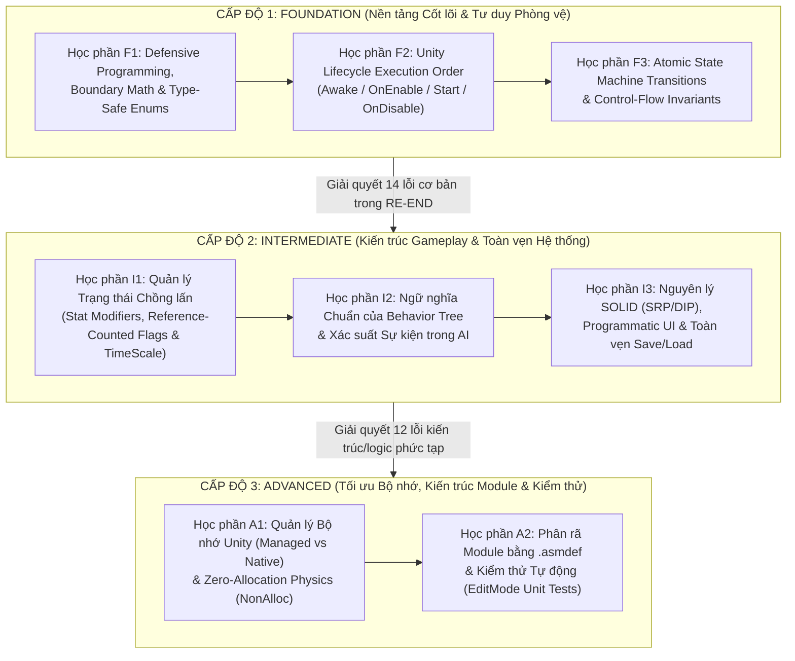

# RE-END — 07. Personal Learning & Practice Roadmap (`07_Personal_Learning_Roadmap.md`)

- **Ngày lập lộ trình:** 2026-11-09
- **Vai trò hướng dẫn:** Principal Unity Engineer & Programming Mentor
- **Mục tiêu cốt lõi:** Giúp người phát triển tự nâng tầm kỹ năng lập trình Unity/C# từ mức **"Làm cho tính năng chạy được (Make it work)"** lên mức **"Thiết kế hệ thống đúng đắn, bền vững và không tự phá vỡ khi mở rộng (Make it right, resilient & maintainable)"**.
- **Nguyên tắc học tập (Mục 6 & Mục 8):**
  1. **Quy tắc 80/20 (Tập trung vào tác động lớn nhất):** Không học dàn trải hàng chục chủ đề lý thuyết cùng lúc. Toàn bộ lộ trình dưới đây chỉ chọn lọc **8 chủ đề cốt lõi chia làm 3 cấp độ** giải quyết trực tiếp **29 lỗi và thiếu sót thực tế** trong **RE-END**.
  2. **Tự Debug trước khi Sửa (Observe Before Fixing):** Với mỗi bài tập trên RE-END, bắt buộc gắn trình gỡ lỗi (IDE Debugger Breakpoint + Call Stack + Watch Window) để **tận mắt nhìn thấy trạng thái biến bị sai lệch tại runtime**, sau đó tự viết giải pháp thay vì sao chép đoạn code sửa sẵn của AI.

---

## Bản đồ Lộ trình Phát triển Kỹ năng (3-Tier Growth Map)



---

## CẤP ĐỘ 1: FOUNDATION (Củng cố Nền tảng & Tư duy Phòng vệ)

> [!IMPORTANT]
> **Tại sao bắt đầu từ cấp độ này?**
> Hơn một nửa số lỗi nghiêm trọng trong RE-END (`[COMBAT-01]`, `[COMBAT-02]`, `[COMBAT-03]`, `[COMBAT-05]`, `[PLAYER-01]`, `[PLAYER-06]`, `[SKILL-03]`, `[BOSS-01]`) không phải do thiếu thuật toán phức tạp, mà xuất phát từ **3 lỗ hổng nền tảng**: (1) thiếu kiểm tra điều kiện biên và dùng chuỗi ký tự rời rạc, (2) nhầm thứ tự chạy `OnEnable`/`Start`, và (3) quên dừng hàm `Tick()` sau khi đã chuyển State.

---

### 1. Chủ đề & Thứ tự học (Topics & Step-by-Step Sequence)

#### Bước 1.1 (Học trước tiên): Defensive Programming, Toán học Biên (Boundary Math) & Định danh An toàn Kiểu (`enum` vs `string`)
- **Khái niệm cần nắm vững:**
  1. **Guard Clauses (Điều kiện bảo vệ đầu hàm):** Trước khi thực hiện bất kỳ thay đổi trạng thái nào (như trừ máu, hủy mục tiêu, trừ điểm nâng cấp), luôn tự hỏi: *"Hàm này có được phép chạy nếu đối tượng đã chết, nếu tham chiếu `null`, hoặc nếu chỉ số đã chạm đáy không?"*
  2. **Clamping hai đầu trong công thức Gameplay:**
     - Không bao giờ viết `currentHealth - damage + resistance` mà không kẹp biên dưới của lượng sát thương:
       $$\Delta \text{HP} = \max(0, \text{damage} - \text{resistance})$$
     - Không bao giờ kiểm tra chạm đáy bằng dấu bằng tuyệt đối với một con số gõ tay (`if (maxHealth == 1000)`). Hãy lưu giá trị gốc lúc khởi tạo (`_minHealth = maxHealth`) và dùng toán tử bất đẳng thức (`if (maxHealth <= _minHealth) return;`).
  3. **Loại bỏ Magic Strings bằng `enum`:** Khi dùng `string` (`"EmeraldGuava"` vs `"ReduceStamina"`), trình biên dịch C# hoàn toàn mù trước lỗi gõ sai tên. Dùng `enum SubPotionType` biến lỗi runtime ngầm thành lỗi biên dịch (Compile-time error) phát hiện được ngay lập tức.

#### Bước 1.2 (Học thứ hai): Thứ tự Vòng đời Unity (`Awake` → `OnEnable` → `Start` → `OnDisable` → `OnDestroy`)
- **Khái niệm cần nắm vững:**
  1. **Tính đồng bộ tức thời của `gameObject.SetActive(true)`:**
     Khi dòng lệnh `obj.SetActive(true)` được gọi (ví dụ bên trong `ObjectPooling.GetPooledObject`), Unity sẽ **dừng ngay dòng lệnh hiện tại để nhảy vào chạy `Awake()` và `OnEnable()` của `obj` ngay lập tức**, rồi mới quay lại chạy dòng code tiếp theo của hàm gọi!
     ```mermaid
     sequenceDiagram
         participant Caller as ThrowSword.Cast()
         participant Pool as ObjectPooling.GetPooledObject()
         participant Obj as SwordSkill (Pooled Prefab)

         Caller->>Pool: GetPooledObject("ThrowSword", pos)
         Pool->>Obj: obj.gameObject.SetActive(true)
         activate Obj
         Note over Obj: SwordSkill.OnEnable() chạy NGAY TẠI ĐÂY!<br/>(Lúc này TargetPosition chưa kịp gán!)
         deactivate Obj
         Pool-->>Caller: return obj
         Caller->>Obj: swordSkill.TargetPosition = targetPos (Quá muộn!)
     ```
  2. **Quy tắc Đối xứng Sự kiện (Event Subscription Symmetry):**
     - Nếu đăng ký `event += Handler` trong `OnEnable()`, bắt buộc hủy `event -= Handler` trong `OnDisable()`.
     - Nếu đăng ký `event += Handler` trong `Start()`, bắt buộc hủy `event -= Handler` trong `OnDestroy()`.
     - **Tuyệt đối không** đăng ký trong `Start()` nhưng lại hủy trong `OnDisable()` (vì khi GameObject tắt đi bật lại, `OnDisable()` chạy nhưng `Start()` không bao giờ chạy lại lần thứ 2!).

#### Bước 1.3 (Học thứ ba): Tính Nguyên tử trong Chuyển đổi Trạng thái (Atomic State Machine Transitions)
- **Khái niệm cần nắm vững:**
  1. **Chồng lệnh thực thi (Call Stack) của `SwitchState(newState)`:**
     Trong [`StateMachine.cs:11-16`](file:///C:/Users/Official_41/Documents/Unity_Project/Unity_3D_Boss-Rush/Assets/Scripts/Design%20Pattern/StateMachine/Base/StateMachine.cs#L11-L16), `SwitchState` không phải là một lời hẹn sang frame sau mới đổi state, mà nó gọi `currentState.Exit()` và `newState.Enter()` **ngay tại dòng lệnh đó**.
  2. **Bất biến bắt buộc:**
     - Mọi nhánh code trong `Tick()` có gọi `SwitchState(...)` (trực tiếp hoặc gián tiếp qua hàm phụ như `TryCombo()`, `CheckCounterattack()`, `OutTargetState()`, `ReturnLocomotion()`) **bắt buộc phải có `return;` ngay lập tức**.
     - Không bao giờ gọi `SwitchState(...)` ở giữa hàm `Enter()` nếu bên dưới nó vẫn còn lệnh thiết lập cho state hiện tại.

---

### 2. Chuỗi Bài tập Thực hành Tự Debug trên RE-END (Foundation Hands-On Labs)

#### Bài tập F-Lab 1: Tự Debug lỗi `SubPotion` và Công thức Máu bằng IDE Breakpoint
1. **Bước chuẩn bị:** Mở project trong IDE (Rider / Visual Studio) và gắn Debugger vào Unity (`Attach to Unity`).
2. **Thực hành 1A (`[COMBAT-01]`):**
   - Đặt Breakpoint tại [`PlayerUseSubPotionState.cs:39`](file:///C:/Users/Official_41/Documents/Unity_Project/Unity_3D_Boss-Rush/Assets/Scripts/Design%20Pattern/StateMachine/Player/Main/PlayerUseSubPotionState.cs#L39).
   - Vào Play Mode, bấm phím dùng Sub-Potion. Khi trình gỡ lỗi dừng lại ở dòng 39, mở cửa sổ **Watch** xem giá trị của `potionName` (`"GoldenPear"`).
   - Bấm `F10` (Step Over) qua dòng 40 (`switch (potionName)`) và quan sát con trỏ thực thi nhảy thẳng xuống dòng 52 (kết thúc hàm mà không vào bất kỳ `case` nào).
   - **Tự sửa:** Thêm `public enum SubPotionType { ReduceStamina, ReduceDamage, IncreaseDamage }` vào [`SubPotion.cs`](file:///C:/Users/Official_41/Documents/Unity_Project/Unity_3D_Boss-Rush/Assets/Scripts/Attack/Status/Potion/SubPotion.cs), cấu hình trên Inspector và viết lại `UsePotion` dùng `enum` thay vì `string`.
3. **Thực hành 1B (`[COMBAT-02]`, `[COMBAT-03]`, `[COMBAT-05]`):**
   - Mở [`Health.cs:79-91`](file:///C:/Users/Official_41/Documents/Unity_Project/Unity_3D_Boss-Rush/Assets/Scripts/Attack/Status/Health.cs#L79-L91) và [`Health.cs:143-153`](file:///C:/Users/Official_41/Documents/Unity_Project/Unity_3D_Boss-Rush/Assets/Scripts/Attack/Status/Health.cs#L143-L153).
   - Tự viết các Guard Clauses ở đầu `DealDamage`, sửa công thức trừ máu với `Mathf.Max(0f, ...)`, và sửa `SubHealth()` / `Mana.SubMana()` / `Stamina.SubStamina()` / `Potion.SubtractUsagePotion()` bằng biến lưu giá trị gốc khởi tạo trong `Awake()`.

#### Bài tập F-Lab 2: Truy vết Call Stack khi `SwitchState` bị ghi đè trong cùng 1 Frame
1. Đặt Breakpoint tại [`StateMachine.cs:13`](file:///C:/Users/Official_41/Documents/Unity_Project/Unity_3D_Boss-Rush/Assets/Scripts/Design%20Pattern/StateMachine/Base/StateMachine.cs#L13) (`currentState?.Exit();`).
2. Mở [`PlayerCloneIdleState.cs:23-30`](file:///C:/Users/Official_41/Documents/Unity_Project/Unity_3D_Boss-Rush/Assets/Scripts/Design%20Pattern/StateMachine/PlayerClone/Main/PlayerCloneIdleState.cs#L23-L30) và đặt thêm Breakpoint tại dòng 27 và dòng 29.
3. Trong Play Mode, đứng sát Boss và dùng kỹ năng `PhantomMirage` để gọi Clone. Khi `_Timer >= ChangeChasingState`, bấm `F11` (Step Into) tại dòng 27 để thấy Clone vừa chạy `PlayerCloneAttackState.Enter()`, rồi ngay khi thoát ra lại chạy tiếp dòng 29 để gọi `PlayerCloneAttackState.Exit()` và vào `PlayerCloneChasingState.Enter()` trong cùng một frame `Update()`!
4. **Tự rà soát và sửa:** Tự kiểm tra toàn bộ 17 file trong `Player/Main/`, 6 file trong `Boss/Main/` và 4 file trong `PlayerClone/Main/`, đảm bảo mọi nhánh gọi `SwitchState` đều kết thúc bằng `return;`.

#### Bài tập F-Lab 3: Sửa lỗi Toán học Camera Viewport và Khóa `CancelTarget` trong `Targeter.cs` (`[PLAYER-06]`)
1. Mở [`Targeter.cs:45-80`](file:///C:/Users/Official_41/Documents/Unity_Project/Unity_3D_Boss-Rush/Assets/Scripts/Target/Targeter.cs#L45-L80).
2. Đặt `Debug.Log(mainCamera.WorldToViewportPoint(target.transform.position))` trong `SelectedTarget()`, xoay Camera quay lưng hẳn lại phía Boss và bấm Lock-on để thấy `z < 0` nhưng `0 <= x, y <= 1`.
3. Tự sửa `SelectedTarget()` (kiểm tra `viewPoint.z > 0f`), `OnTriggerExit()` (gọi `RemoveTarget(target)`), và `CancelTarget()` (kiểm tra `if (currentTarget == null) return;` thay vì `if (targetList.Count == 0) return;`).

---

### 3. Mini-Project Độc lập Cấp độ 1 (Foundation Standalone Kata)
- **Tên bài tập:** **"Atomic State Machine & Guarded Combat Sandbox"**
- **Yêu cầu tự xây dựng (trong một Scene trống hoặc project nhỏ mới):**
  1. Viết lớp cơ sở `SafeStateMachine` có biến `private int _lastTransitionFrame = -1;` và `private bool _isInEnterOrExit = false;`.
     - Nếu `SwitchState` bị gọi khi `_isInEnterOrExit == true`, in ra `Debug.LogError("Reentrancy detected: SwitchState called inside Enter/Exit!")`.
     - Nếu `SwitchState` bị gọi 2 lần trong cùng một `Time.frameCount`, in ra `Debug.LogError($"Double transition in frame {Time.frameCount}!")`.
  2. Gắn `SafeStateMachine` này thay thế tạm thời vào `StateMachine.cs` của RE-END và chơi thử 5 phút. Mọi chỗ thiếu `return;` sẽ tự động báo đỏ trên Console kèm Call Stack chính xác!

---

### 4. Cách Kiểm tra Kết quả & Tiêu chí Nắm vững Cấp độ 1 (Mastery Checklist)
- [ ] **Câu hỏi tự kiểm tra 1:** Tại sao `if (maxHealth == 1000)` trong `Health.SubHealth()` lại nguy hiểm hơn `if (maxHealth <= _initialMaxHealth)` ngay cả khi Prefab có máu bằng 1000? *(Gợi ý: Điều gì xảy ra nếu một hiệu ứng làm `maxHealth` lẻ hoặc giảm 2 đơn vị một lúc?)*
- [ ] **Câu hỏi tự kiểm tra 2:** Tại sao `Vector2 viewPoint = cam.WorldToViewportPoint(pos)` lại làm mất thông tin mục tiêu đứng trước hay đứng sau Camera?
- [ ] **Kiểm chứng kỹ thuật trên RE-END:**
  - `SafeStateMachine` không báo bất kỳ lỗi `Reentrancy` hay `Double transition` nào trong suốt trận đấu.
  - Uống cả 3 loại Sub-Potion đều kích hoạt đúng hiệu ứng trong 20 giây.
  - Bấm `-` tại Checkpoint không bao giờ làm giảm chỉ số xuống dưới mức khởi điểm.

---

## CẤP ĐỘ 2: INTERMEDIATE (Kiến trúc Gameplay, AI, SOLID & Toàn vẹn Save/Load)

> [!IMPORTANT]
> **Tại sao học cấp độ này tiếp theo?**
> Sau khi các hàm đơn lẻ đã chạy đúng ở Cấp độ 1, Cấp độ 2 giải quyết **bài toán tương tác giữa nhiều hệ thống theo thời gian**: làm sao để nhiều kỹ năng/buff cùng bật mà không ghi đè lẫn nhau (`[COMBAT-04]`, `[COMBAT-06]`, `[SKILL-01]`, `[SKILL-02]`), làm sao để Behavior Tree của Boss hoạt động chuẩn xác (`[BOSS-02]`, `[BOSS-03]`), và làm sao để tách nhỏ God Class cũng như bảo toàn dữ liệu Save/Load (`[LIFE-01..05]`).

---

### 1. Chủ đề & Thứ tự học (Topics & Step-by-Step Sequence)

#### Bước 2.1: Quản lý Trạng thái Chồng lấn (Stat Modifiers, Reference-Counted Flags & TimeScale Controller)
- **Khái niệm cần nắm vững:**
  1. **Tách biệt Base Stat và Runtime Modifiers:**
     - Tuyệt đối không bao giờ viết `AttackData[i].AttackDamage *= 2` (`WorldBreaker` trong `PlayerStateMachine.cs:374`). Khi bạn nhân trực tiếp vào biến chứa dữ liệu gốc, bạn đã xóa mất thông tin "giá trị gốc ban đầu là bao nhiêu" và nếu `AutoSave()` chạy vào lúc đó, giá trị nhân đôi sẽ bị lưu vĩnh viễn vào file save!
     - **Mô hình chuẩn:** Giữ `BaseDamage` bất biến (chỉ thay đổi khi nâng cấp vĩnh viễn ở Checkpoint), và tính sát thương khi ra đòn bằng hàm:
       ```csharp
       public float GetEffectiveDamage(int comboIndex)
       {
           float baseDmg = AttackData[comboIndex].AttackDamage;
           float multiplier = 1f;
           if (IsIncreaseDamePotion) multiplier *= 1.5f;
           if (Invincible) multiplier *= 2.0f; // WorldBreaker active
           return baseDmg * multiplier;
       }
       ```
  2. **Reference Counting (Bộ đếm nguồn kích hoạt) thay cho `bool` dùng chung:**
     - Khi cả `PlayerDodgeState` và kỹ năng `Indestructible` cùng dùng chung một biến `public bool noDamage`, hệ thống nào kết thúc trước và gán `noDamage = false` sẽ vô tình tắt luôn hiệu ứng của hệ thống kia!
     - **Mô hình chuẩn:**
       ```csharp
       private int _invulnerableSourceCount = 0;
       public bool noDamage => _invulnerableSourceCount > 0;
       public void AddInvulnerability() => _invulnerableSourceCount++;
       public void RemoveInvulnerability() => _invulnerableSourceCount = Mathf.Max(0, _invulnerableSourceCount - 1);
       ```
  3. **Điều phối `Time.timeScale` không xung đột:**
     - Thay vì để `TimeFreeHit()` và `SlowTime()` tự ý gán `Time.timeScale = 1f` khi hết Coroutine, hãy lưu thời điểm kết thúc của từng hiệu ứng theo `Time.unscaledTime` (`_hitStopEndTime`, `_slowMoEndTime`). Nếu `Time.unscaledTime < _hitStopEndTime` thì `timeScale = 0f`; ngược lại nếu `Time.unscaledTime < _slowMoEndTime` thì `timeScale = 0.5f`; khi cả hai đều hết hạn mới trả về `1.0f`.

#### Bước 2.2: Ngữ nghĩa Chuẩn của Behavior Tree (`Sequence` / `Running`) & Xác suất theo Sự kiện
- **Khái niệm cần nắm vững:**
  1. **Tại sao `BehaviorSequence` phải dừng lại ngay khi gặp `NodeState.Running`?**
     - Một `Sequence` biểu diễn chuỗi hành động $A \rightarrow B \rightarrow C$. Nếu $A$ đang thực hiện dở (`Running`), thì $B$ và $C$ **chưa được phép chạy**. Trong [`BehaviorSequence.cs:25-27`](file:///C:/Users/Official_41/Documents/Unity_Project/Unity_3D_Boss-Rush/Assets/Scripts/Design%20Pattern/Tree%20Behavior/Base/BehaviorSequence.cs#L25-L27), việc viết `case NodeState.Running: anyChildIsRunning = true; continue;` khiến các node phía sau vẫn bị gọi `Evaluate()` trong khi node trước chưa xong!
  2. **Phân biệt "Tung xúc xắc 1 lần khi có sự kiện" vs "Tung xúc xắc 60 lần mỗi giây trong `Update()`":**
     - Trong [`CheckCounterAttackNode.cs:22-23`](file:///C:/Users/Official_41/Documents/Unity_Project/Unity_3D_Boss-Rush/Assets/Scripts/Design%20Pattern/Tree%20Behavior/Boss%20Leaf%20Node/CheckCounterAttackNode.cs#L22-L23), gọi `Random.Range(min, max)` bên trong `Evaluate()` (chạy mỗi frame) giống như việc mỗi 16ms bạn lại gieo xúc xắc lại một lần cho đến khi ra mặt 6. Ngưỡng ngẫu nhiên `_requiredHits` phải được chọn **1 lần duy nhất** và so sánh bằng `HitReceived >= _requiredHits`.

#### Bước 2.3: Nguyên lý SOLID thực chiến (SRP/DIP), Programmatic UI Binding & Toàn vẹn Save/Load
- **Khái niệm cần nắm vững:**
  1. **Single Responsibility Principle (SRP) trên MonoBehaviour:**
     - Một component gắn lên cả Player, Boss và Clone (như `Health.cs`) chỉ nên chứa dữ liệu và hành vi chung của mọi thực thể có máu. Không đưa logic nâng cấp điểm `PlayerSpiritualPower` hay kiểm tra `gameObject.tag != "Boss"` vào trong `Health.cs`.
  2. **Programmatic UI Binding (`AddListener` bằng code) & Tái sử dụng Panel:**
     - Trong `Main.unity`, 6 nút bấm của `SubPotion` bị hỏng (`m_Target: {fileID: 0}`) vì kéo thả sự kiện `OnClick` thủ công trên Inspector của Scene; khi thay đổi Prefab `Player`, toàn bộ liên kết trong Scene bị đứt mà trình biên dịch không hề báo lỗi!
     - Đăng ký sự kiện bằng code C# (`button.onClick.AddListener(...)` trong `Start()`/`OnEnable()`) giúp trình biên dịch kiểm tra kiểu an toàn và dễ dàng tìm kiếm bằng `Find All References`.
  3. **Bất biến của Hệ thống Save/Load:**
     - **Bất biến 1 (Initial State):** Ngay khi bắt đầu `New Game` và load xong `Main.unity`, phải tạo ngay bản lưu khởi điểm tại vị trí xuất phát ban đầu (tránh lỗi `[LIFE-01]` hồi sinh toàn số `0` tại `(0,0,0)`).
     - **Bất biến 2 (Order of Operations):** Phải cập nhật xong toàn bộ phần thưởng (`AddBossSpiritualPower`, `CompletedList.Add`) **trước khi** gọi `AutoSave()` (`[LIFE-02]`, `[LIFE-03]`).

---

### 2. Chuỗi Bài tập Thực hành Tự Refactor trên RE-END (Intermediate Hands-On Labs)

#### Bài tập I-Lab 1: Sửa `WorldBreaker`, Bộ đếm `noDamage` và Bộ điều phối `TimeScale`
1. Mở [`PlayerStateMachine.cs:367-376`](file:///C:/Users/Official_41/Documents/Unity_Project/Unity_3D_Boss-Rush/Assets/Scripts/Design%20Pattern/StateMachine/Player/Base/PlayerStateMachine.cs#L367-L376) và [`Skill.cs:135-161`](file:///C:/Users/Official_41/Documents/Unity_Project/Unity_3D_Boss-Rush/Assets/Scripts/Attack/Skill%20Factory/Skill.cs#L135-L161).
2. Tự thiết kế cơ chế bật/tắt `WorldBreaker` trong 15 giây mà **không sửa trực tiếp mảng `AttackData[i].AttackDamage`** và không khóa các kỹ năng khác.
3. Mở [`Health.cs:99-127`](file:///C:/Users/Official_41/Documents/Unity_Project/Unity_3D_Boss-Rush/Assets/Scripts/Attack/Status/Health.cs#L99-L127), thay `bool noDamage` bằng bộ đếm nguồn bất tử và sửa `TimeFreeHit()` / `SlowTime()` để không hủy sớm Slow Motion của Perfect Dodge khi chém trúng Boss.

#### Bài tập I-Lab 2: Sửa Behavior Tree của Boss và Dọn dẹp `SituationEvent`
1. Mở [`BehaviorSequence.cs:14-34`](file:///C:/Users/Official_41/Documents/Unity_Project/Unity_3D_Boss-Rush/Assets/Scripts/Design%20Pattern/Tree%20Behavior/Base/BehaviorSequence.cs#L14-L34) và [`CheckCounterAttackNode.cs:18-30`](file:///C:/Users/Official_41/Documents/Unity_Project/Unity_3D_Boss-Rush/Assets/Scripts/Design%20Pattern/Tree%20Behavior/Boss%20Leaf%20Node/CheckCounterAttackNode.cs#L18-L30), tự sửa lại logic `Running` và biến `_targetHitCount`.
2. Mở [`ManageAnimationSkillEvent.cs`](file:///C:/Users/Official_41/Documents/Unity_Project/Unity_3D_Boss-Rush/Assets/Scripts/Design%20Pattern/EventBus/ManageAnimationSkillEvent.cs) và [`Skill.cs`](file:///C:/Users/Official_41/Documents/Unity_Project/Unity_3D_Boss-Rush/Assets/Scripts/Attack/Skill%20Factory/Skill.cs), đảm bảo mỗi khi Boss bị ngắt đòn sang `BossHitState` hoặc thoát `BossAttackState`, các closure cũ trên `SituationEvent` đều được xóa sạch (`ClearSituationEvent()`).

#### Bài tập I-Lab 3: Khôi phục Toàn vẹn Save/Load & Nối lại UI
1. Mở [`SaveData.cs`](file:///C:/Users/Official_41/Documents/Unity_Project/Unity_3D_Boss-Rush/Assets/Scripts/Managers/SaveData.cs), [`SaveManagers.cs`](file:///C:/Users/Official_41/Documents/Unity_Project/Unity_3D_Boss-Rush/Assets/Scripts/Managers/SaveManagers.cs), [`GameManagers.cs`](file:///C:/Users/Official_41/Documents/Unity_Project/Unity_3D_Boss-Rush/Assets/Scripts/Managers/GameManagers.cs), [`BossPhaseManager.cs`](file:///C:/Users/Official_41/Documents/Unity_Project/Unity_3D_Boss-Rush/Assets/Scripts/Managers/BossPhaseManager.cs), và [`CutsceneManagers.cs`](file:///C:/Users/Official_41/Documents/Unity_Project/Unity_3D_Boss-Rush/Assets/Scripts/Cutscene/CutsceneManagers.cs).
2. Tự tay sửa dứt điểm 3 lỗi `[LIFE-01]`, `[LIFE-02]`, `[LIFE-03]`, đồng thời bổ sung `AddListener` cho các control `*NonCheckpoint` trong [`GraphicsUI.cs:111-179`](file:///C:/Users/Official_41/Documents/Unity_Project/Unity_3D_Boss-Rush/Assets/Scripts/UI/GraphicsUI.cs#L111-L179) và nối lại 6 nút UI Sub-Potion trong `Main.unity`.

---

### 3. Mini-Project Độc lập Cấp độ 2 (Intermediate Standalone Kata)
- **Tên bài tập:** **"Non-Destructive Buff & Time-Dilation Scheduler"**
- **Yêu cầu tự xây dựng:**
  - Viết một hệ thống nhỏ gồm 2 class không phụ thuộc vào RE-END:
    1. `CharacterStats`: Quản lý `AttackDamage` gốc là `40`. Cho phép kích hoạt đồng thời:
       - Buff A (`+50%` trong `5s`)
       - Buff B (`x2` trong `3s`)
       - Và một hàm `ExportToSaveDTO()` chỉ xuất ra đúng chỉ số gốc (`40`), bất kể đang có bao nhiêu buff đang chạy.
    2. `TimeScaleScheduler`: Cho phép gửi nhiều yêu cầu `RequestTimeScale(float scale, float durationRealtime, int priority)`. Khi có nhiều yêu cầu chồng lấn, luôn áp dụng `scale` của yêu cầu có `priority` cao nhất còn hiệu lực; khi hết mọi yêu cầu thì tự về `1.0f`.

---

### 4. Cách Kiểm tra Kết quả & Tiêu chí Nắm vững Cấp độ 2 (Mastery Checklist)
- [ ] **Câu hỏi tự kiểm tra 1:** Nếu người chơi bật `WorldBreaker`, uống thêm bình `BloodPomegranate` (`IncreaseDame`), rồi ngồi vào Checkpoint để game tự động `AutoSave()`, file `ReSave.json` trên ổ cứng phải lưu `AttackDamage` là bao nhiêu? Khi tắt game mở lại (`Continue`), sát thương của 4 đòn đánh là bao nhiêu?
- [ ] **Câu hỏi tự kiểm tra 2:** Tại sao việc gọi `Finished?.Invoke()` trước `Player.AddBossSpiritualPower(spiritualPower)` trong `BossPhaseManager.cs:94-100` lại làm mất điểm thưởng trong file save?
- [ ] **Kiểm chứng kỹ thuật trên RE-END:**
  - Bấm New Game -> chạy thẳng vào Boss để bị giết ngay lập tức -> nhân vật hồi sinh đúng tại vị trí xuất phát với `500` HP, `100` Mana, `1000` Stamina, sát thương `[40, 40, 45, 50]`.
  - Bật `Indestructible` -> lộn nhào `Dodge` -> để Boss đánh trúng ngay sau khi hết lộn nhào -> không mất máu.

---

## CẤP ĐỘ 3: ADVANCED (Tối ưu Bộ nhớ, Quản lý Tài nguyên Native & Kiểm thử Tự động)

> [!IMPORTANT]
> **Tại sao học cấp độ này ở bước cuối?**
> Khi toàn bộ logic và kiến trúc của dự án đã đúng đắn và sạch sẽ sau Cấp độ 1 và 2, Cấp độ 3 trang bị cho bạn những kỹ năng phân biệt một lập trình viên Unity chuyên nghiệp (Senior/Mid-level vững) với người mới: **đo đạc và triệt tiêu cấp phát bộ nhớ rác (Zero-Allocation Gameplay Loop)**, **thiết lập ranh giới kiến trúc bằng `.asmdef`**, và **viết Unit Test tự động để khóa chặt các lỗi đã sửa**.

---

### 1. Chủ đề & Thứ tự học (Topics & Step-by-Step Sequence)

#### Bước 3.1: Quản lý Bộ nhớ Unity (Managed Heap vs Native Memory) & Zero-Allocation Physics
- **Khái niệm cần nắm vững:**
  1. **Tại sao `Physics.OverlapBox` và `Physics.BoxCastAll` tạo rác bộ nhớ (GC Allocation) mỗi frame?**
     - Trong [`WeaponTrail.cs:48, 56`](file:///C:/Users/Official_41/Documents/Unity_Project/Unity_3D_Boss-Rush/Assets/Scripts/Attack/WeaponTrail.cs#L48-L56), mỗi lần gọi `Physics.OverlapBox(...)`, Unity phải cấp phát một mảng `Collider[]` mới trên Managed Heap để trả kết quả về. Khi vung kiếm ở 120 FPS (hoặc khi có cả Player, Boss và 3 Clone cùng vung kiếm), hàng trăm mảng nhỏ được tạo ra rồi vứt bỏ mỗi giây, buộc Garbage Collector (GC) phải dừng luồng chính để dọn rác.
     - **Giải pháp chuẩn:** Dùng `Physics.OverlapBoxNonAlloc` và `Physics.BoxCastNonAlloc` ghi kết quả vào một mảng đệm cố định được cấp phát 1 lần duy nhất lúc khởi tạo (`private readonly Collider[] _overlapBuffer = new Collider[16];`).
  2. **Vòng đời của `AnimatorOverrideController` và các đối tượng Native Wrapper:**
     - Trong [`PlayerBaseState.cs:76-81`](file:///C:/Users/Official_41/Documents/Unity_Project/Unity_3D_Boss-Rush/Assets/Scripts/Design%20Pattern/StateMachine/Player/Base/PlayerBaseState.cs#L76-L81), mỗi lần rút kiếm hoặc cất kiếm lại gọi `new AnimatorOverrideController(playerStateMachine.Animator.runtimeAnimatorController)`. Việc bọc chồng một `AnimatorOverrideController` lên một `AnimatorOverrideController` khác vừa tạo rác bộ nhớ, vừa làm sâu chuỗi tra cứu animation. Chỉ cần tạo **1 instance duy nhất** trong `PlayerStateMachine.Start()` và đổi clip trên instance đó.

#### Bước 3.2: Phân rã Module bằng Assembly Definitions (`.asmdef`) & Kiểm thử Tự động (EditMode Unit Tests)
- **Khái niệm cần nắm vững:**
  1. **Ranh giới Kiến trúc ở Tầng Biên dịch (`.asmdef`):**
     - Hiện tại toàn bộ 110 script của RE-END nằm chung trong `Assembly-CSharp.csproj`, dẫn tới việc `Health.cs` (tầng Status cơ bản) có thể thoải mái gọi ngược lên `PlayerStateMachine.cs` (tầng điều khiển cấp cao), tạo ra phụ thuộc vòng (Circular Dependency).
     - Khi tách `ReEnd.Core` (chứa `StateMachine`, `BehaviorTree`, `InputBuffering`, `ObjectPooling`) không tham chiếu tới `ReEnd.Gameplay`, trình biên dịch C# sẽ ngăn chặn mọi hành vi coupling ngược ngay từ lúc viết code.
  2. **Thiết kế Code dễ kiểm thử (Testable Code / Humble Object Pattern) & NUnit EditMode Tests:**
     - Tách các công thức tính toán (như tính sát thương, kiểm tra điều kiện nâng/hạ cấp chỉ số, logic `BehaviorSequence`, `InputBuffering`) ra khỏi các phụ thuộc cứng vào Scene để có thể chạy hàng chục bài kiểm thử tự động trong **0.1 giây** bằng **Unity Test Runner (EditMode)** mà không cần bấm Play.

---

### 2. Chuỗi Bài tập Thực hành Chuyên sâu trên RE-END (Advanced Hands-On Labs)

#### Bài tập A-Lab 1: Thực hành Đo đạc trên Unity Profiler & Chuyển sang `NonAlloc`
1. Mở `Window -> Analysis -> Profiler` trong Unity Editor, chọn module **CPU Usage**, chuyển sang chế độ **Hierarchy**, và sắp xếp giảm dần theo cột **`GC Alloc`**.
2. Vào Play Mode, thực hiện 10 lần rút/cất kiếm (`PlayerChangeAction`) và 20 nhát chém liên tiếp (`WeaponTrail.LateUpdate`). Ghi lại con số `GC Alloc` xuất hiện ở 2 hàm này.
3. Tự tay viết lại `WeaponTrail.LateUpdate()` sử dụng `Physics.OverlapBoxNonAlloc` và `Physics.BoxCastNonAlloc` (chú ý chỉ duyệt vòng lặp `for (int i = 0; i < hitCount; i++)` thay vì duyệt hết độ dài mảng đệm!), và sửa `PlayerBaseState.ChangeSwordIdle()` dùng 1 `AnimatorOverrideController` được cache sẵn.
4. Chạy lại Profiler và xác nhận cột `GC Alloc` của cả hai hàm giảm về đúng **`0 B`**.

#### Bài tập A-Lab 2: Viết Bộ 10 EditMode Unit Tests Đầu tiên cho RE-END
1. Mở `Window -> General -> Test Runner`, chọn tab **EditMode**, bấm `Create EditMode Test Assembly Folder` để tạo thư mục `Assets/Tests/EditMode/`.
2. Tự viết 10 bài test (`[Test]`) kiểm chứng các logic mà bạn đã sửa ở Cấp độ 1 và 2:
   - **Test 1–3 (`Health`):** Kiểm tra `DealDamage(5)` khi `resistance = 10` không làm tăng máu; kiểm tra `DealDamage` khi `currentHealth == 0` không bắn `HitAction` hay `DeathAction`; kiểm tra đòn kết liễu chỉ bắn `DeathAction` chứ không bắn `HitAction`.
   - **Test 4–5 (`SubHealth` / `SubMana`):** Kiểm tra khi `maxHealth == 500` (giá trị gốc), gọi `SubHealth()` không làm giảm `maxHealth` và bật cờ `isCanNotAddSpiritual = true`.
   - **Test 6–8 (`BehaviorSequence`):** Tạo 3 mock node con; kiểm tra khi node 1 trả về `Running`, node 2 và node 3 **không bị gọi `Evaluate()`** và cả `BehaviorSequence` trả về `Running`.
   - **Test 9–10 (`noDamage` Reference Counting):** Gọi `AddInvulnerability()` 2 lần (từ Dodge và từ Skill), sau đó gọi `RemoveInvulnerability()` 1 lần (khi Dodge kết thúc), khẳng định `noDamage` vẫn bằng `true`!

---

### 3. Mini-Project Độc lập Cấp độ 3 (Advanced Standalone Kata)
- **Tên bài tập:** **"Zero-Allocation Swept Hitbox & Unit-Tested Combat Engine"**
- **Yêu cầu tự xây dựng:**
  1. Tạo 2 Assembly Definitions: `CombatCore.Runtime.asmdef` và `CombatCore.EditorTests.asmdef`.
  2. Trong `CombatCore.Runtime`:
     - Viết bộ quét va chạm `SweptBoxDetector` sử dụng `OverlapBoxNonAlloc` + `BoxCastNonAlloc` và `HashSet<int> _hitInstanceIds` được cấp phát sẵn dung lượng (`capacity = 32`) để đạt **0 byte GC allocation** trong suốt vòng đời.
     - Viết class `DamageResolver` thuần C# xử lý công thức sát thương, giáp, giảm sát thương theo phần trăm, và hệ số nhân buff.
  3. Trong `CombatCore.EditorTests`:
     - Viết bộ Unit Test đạt độ bao phủ 100% các nhánh logic của `DamageResolver`.

---

### 4. Cách Kiểm tra Kết quả & Tiêu chí Nắm vững Cấp độ 3 (Mastery Checklist)
- [ ] **Câu hỏi tự kiểm tra 1:** Khi dùng `int count = Physics.OverlapBoxNonAlloc(pos, halfExtents, _buffer, rot, mask)`, tại sao bắt buộc phải duyệt `for (int i = 0; i < count; i++)` mà **không được** dùng `foreach (var col in _buffer)`? *(Gợi ý: Các phần tử từ chỉ số `count` đến `_buffer.Length - 1` chứa gì từ các frame trước?)*
- [ ] **Câu hỏi tự kiểm tra 2:** Tại sao việc tách logic tính toán ra khỏi `MonoBehaviour` (hoặc tách thành các phương thức độc lập không phụ thuộc `SceneManager`/`Camera.main`) lại giúp viết EditMode Unit Test nhanh gấp hàng chục lần PlayMode Test?
- [ ] **Kiểm chứng kỹ thuật trên RE-END:**
  - Cửa sổ **Unity Test Runner** hiển thị màu xanh lá (`Pass 10/10`) cho toàn bộ các bài test EditMode.
  - Cửa sổ **Unity Profiler** xác nhận `WeaponTrail.LateUpdate()` và `PlayerChangeAction.Exit()` phát sinh `0 B` `GC.Alloc`.

---

## Bảng Tổng hợp Đối chiếu: Từ Lỗi trong RE-END đến Bài tập Thực hành

| Mã Lỗi trong RE-END | Nguyên nhân gốc (Root Cause) | Cấp độ Học tập | Bài tập Thực hành Tương ứng |
| :--- | :--- | :---: | :--- |
| `COMBAT-01` | Dùng magic string lệch giữa Prefab (`"EmeraldGuava"`) và code (`"ReduceStamina"`) | **Foundation (Bước 1.1)** | **Bài tập F-Lab 1A** |
| `COMBAT-02`, `COMBAT-03`, `COMBAT-05` | Thiếu chặn biên dưới `Mathf.Max(0, ...)`, thiếu dead guard, hardcode `== 1000` | **Foundation (Bước 1.1)** | **Bài tập F-Lab 1B** & **A-Lab 2** |
| `SKILL-03`, `SKILL-04`, `SKILL-05` | Hiểu chưa rõ thứ tự `SetActive(true)` -> `OnEnable()`, quên reset con trong Pool, lệch `Start`/`OnDisable` | **Foundation (Bước 1.2)** | **Bước 1.2** & **I-Lab 2** |
| `PLAYER-01`, `PLAYER-03`, `BOSS-01`, `BOSS-04` | Thiếu `return;` sau `SwitchState`, gọi `SwitchState` trong `Enter()`, gán nhầm tag Animator | **Foundation (Bước 1.3)** | **Bài tập F-Lab 2** & **Foundation Mini-Project** |
| `PLAYER-05`, `PLAYER-06` | Quên kiểm tra `viewPoint.z > 0` sau lưng Camera, khóa `CancelTarget` khi `targetList` rỗng | **Foundation (Bước 1.1 & 1.3)** | **Bài tập F-Lab 3** |
| `COMBAT-04`, `COMBAT-06`, `SKILL-01` | Nhân trực tiếp vào `AttackDamage` gốc, dùng chung `bool noDamage`, xung đột `Time.timeScale` | **Intermediate (Bước 2.1)** | **Bài tập I-Lab 1** & **Intermediate Mini-Project** |
| `BOSS-02`, `BOSS-03`, `SKILL-02` | `BehaviorSequence` không dừng khi `Running`, gọi `Random.Range` mỗi frame, rò rỉ `SituationEvent` | **Intermediate (Bước 2.2)** | **Bài tập I-Lab 2** & **A-Lab 2** |
| `LIFE-01`, `LIFE-02`, `LIFE-03`, `LIFE-04`, `LIFE-05` | Thiếu `AutoSave` đầu New Game, lưu trước khi cộng thưởng, lệch `CompletedList`, đứt `OnClick` UI | **Intermediate (Bước 2.3)** | **Bài tập I-Lab 3** |
| `COMBAT-09`, `PLAYER-02` | Cấp phát mảng mỗi frame trong `OverlapBox`/`BoxCastAll`, bọc lồng `new AnimatorOverrideController` | **Advanced (Bước 3.1)** | **Bài tập A-Lab 1** & **Advanced Mini-Project** |

---

## Tài liệu Tham khảo Chính thống Đã Xác Minh (Verified Official References)

1. **Tài liệu chính thức của Unity (Unity 6 Manual & Scripting API):**
   - **Thứ tự thực thi Vòng đời MonoBehaviour (`Awake`, `OnEnable`, `Start`, `Update`, `LateUpdate`, `OnDisable`, `OnDestroy`):**
     https://docs.unity3d.com/6000.0/Documentation/Manual/execution-order.html
   - **Truy vấn Vật lý Không Cấp phát Bộ nhớ (`Physics.OverlapBoxNonAlloc`, `Physics.BoxCastNonAlloc`):**
     https://docs.unity3d.com/6000.0/Documentation/ScriptReference/Physics.OverlapBoxNonAlloc.html
   - **Quản lý Bộ nhớ & Garbage Collector trong Unity:**
     https://docs.unity3d.com/6000.0/Documentation/Manual/performance-garbage-collector.html
   - **Tổ chức Kiến trúc với Assembly Definitions (`.asmdef`):**
     https://docs.unity3d.com/6000.0/Documentation/Manual/assembly-definition-files.html
   - **Kiểm thử Tự động với Unity Test Framework (EditMode & PlayMode Tests):**
     https://docs.unity3d.com/Packages/com.unity.test-framework@1.4/manual/index.html
2. **Sách & Tài liệu Kiến trúc Game Kinh điển:**
   - **Robert Nystrom — *Game Programming Patterns*** (Đọc kỹ các chương: *State*, *Object Pool*, *Event Queue*, *Component*):
     https://gameprogrammingpatterns.com/
   - **Michele Colledanchise & Petter Ögren — *Behavior Trees in Robotics and AI: An Introduction*** (Chương 1 & Chương 2 về ngữ nghĩa chuẩn của node `Sequence`, `Fallback/Selector`, và trạng thái `Running`).
